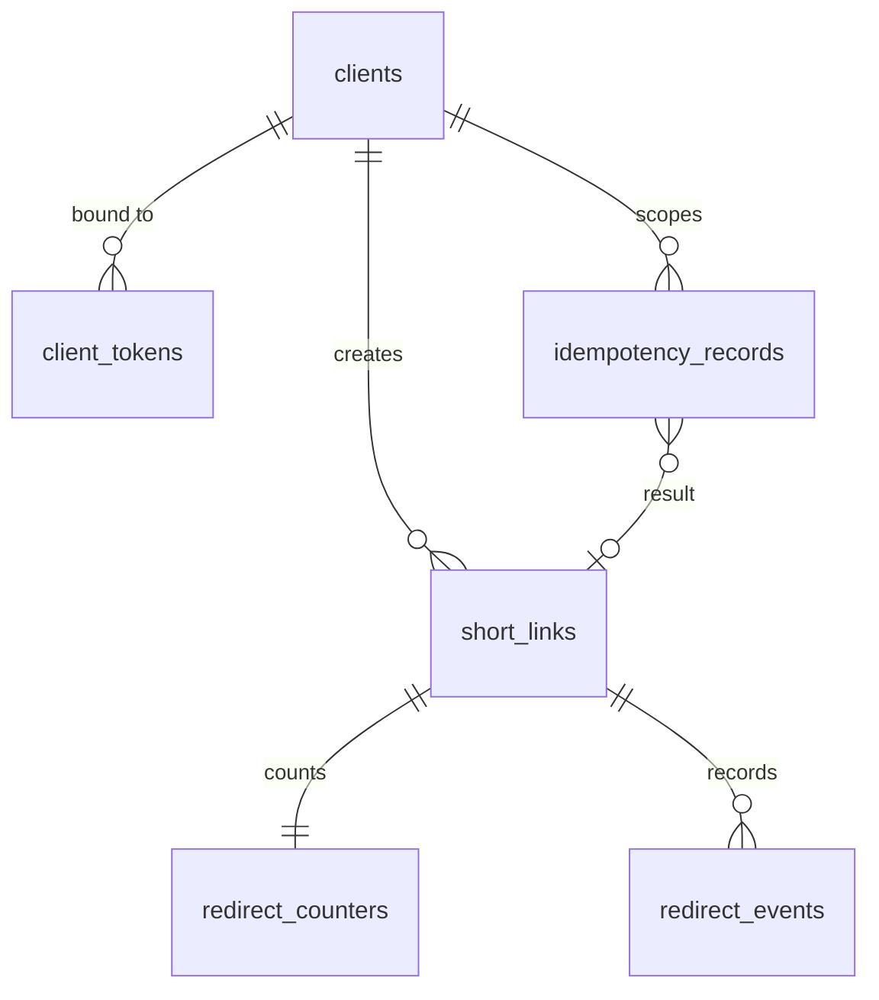
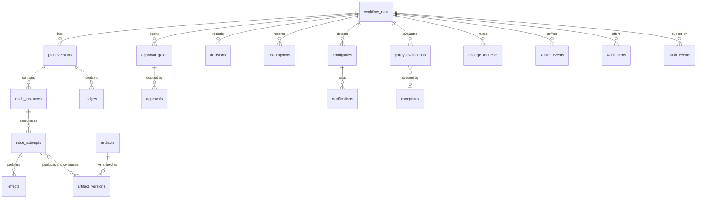

# Data Model: Application Plane and Control Plane

**Feature**: `001-agentic-sdlc-url-shortener` | **Spec**: [spec.md](spec.md) v1.13 | **Plan**: [plan.md](plan.md)

Design only. Column lists describe the persistence schema to be implemented test-first; they are not migrations. Every table lists the requirement IDs it serves. All timestamps are UTC, RFC 3339, with a `clock_kind` (`WALL` or `SIMULATED`) wherever a duration or deadline matters (PA-009, ADR-010). Technology (approved, DEC-060): PostgreSQL (ADR-003), one database per plane with one least-privilege role per plane, so each plane owns its data; Redis (ADR-015) is an accelerator for the application plane only and never the source of truth. Type notes: `timestamptz` for timestamps, `text` with the `"C"` (binary) collation where case-sensitive uniqueness matters, `jsonb` for structured payloads, `uuid` for time-ordered identifiers.

## 1. Data Ownership

| Data | Owner | Reader access | Notes |
|------|-------|---------------|-------|
| Short links, redirect counters, redirect events, idempotency records, clients, application audit events | Application plane (PostgreSQL database `urlshortener`, role `shortener_app`; the container bootstrap role `app` is used only by `migrate`, DEC-113) | Application plane only. The control plane never reads it. | Scenario evidence about the shortener comes from its tests and API, not from its database. |
| Workflow runs, plans, nodes, attempts, artifacts, decisions, approvals, policies, audit events, failure events | Control plane (PostgreSQL database `orchestrator`, role `orchestrator_app`) | Control plane API with a reader credential (read-only audit role, DEC-018) | Audit tables are append-only, enforced by triggers and by revoking `UPDATE` and `DELETE` from `orchestrator_app`. |
| Credentials and secrets | Control plane initialization (`.secrets/`, hashes in the database) | Never exposed | Not in the repository, logs, or audit data. |

## 2. Application Plane

### 2.1 Entity Relationships



### 2.2 Tables

**`clients`** (ASM-012, DEC-053, DEC-057; FR-015, FR-022, FR-023)

| Column | Type | Rules |
|--------|------|-------|
| `client_id` | text, primary key | Random identifier (not derived from the address). |
| `ip_hash` | text, unique | HMAC-SHA-256 of the peer address with a server secret, truncated to 128 bits, hex. The first-contact identifier. The raw address is never stored or logged. |
| `created_at` | timestamp | First contact. |

**`client_tokens`** (ASM-012, PA-005)

| Column | Type | Rules |
|--------|------|-------|
| `token_hash` | text, primary key | SHA-256 of the issued session token. The token itself is never stored. |
| `client_id` | text, foreign key to `clients` | A token is bound to the client identified at first contact (DEC-057). |
| `issued_at` | timestamp | |

Client resolution: a presented valid token resolves to its bound client. With no token, the client is the one whose `ip_hash` equals the hash of the current peer address, created on first contact. A token is issued in the first creation response when none was presented.

**`short_links`** (FR-001, FR-002, FR-006, FR-008, FR-010, FR-011; CON for CR-001 below)

| Column | Type | Rules |
|--------|------|-------|
| `short_code` | text, primary key, binary collation | 7 characters of base62, case-sensitive (ASM-015). Unique over active and expired links; never reassigned (FR-006, FR-010). |
| `normalized_url` | text, not null | The FR-002 normalized URL, at most 2048 characters (DEC-008). |
| `creator_client_id` | text, foreign key to `clients` | Read access to the count (DEC-049). |
| `created_at` | timestamp | |
| `expires_at` | timestamp, not null | Always resolved and persisted (DEC-023). |
| `expiry_source` | text | `SUPPLIED` or `DEFAULT`. |

Status is derived, never stored: `expired` when `now >= expires_at`, otherwise `active`. The only statuses are active and expired (DEC-039). The boundary comparison is a single rule, `now >= expires_at` means expired, applied by one function used by every read path (FR-011).

*Change CR-001 (Scenario B), not part of v1.0:* adds `metadata_json` (canonical JSON, nullable). Planned as migration `0002`; bounds are decided by the Scenario B workflow (ASM-008).

**`redirect_counters`** (FR-012, FR-017, FR-023, DEC-055)

| Column | Type | Rules |
|--------|------|-------|
| `short_code` | text, primary key, foreign key | |
| `redirect_count` | integer, not null, default 0 | Aggregate, kept for the life of the link. Incremented in the same transaction that inserts the redirect event. |

**`redirect_events`** (FR-012, FR-013, ASM-016)

| Column | Type | Rules |
|--------|------|-------|
| `event_id` | integer, primary key | |
| `short_code` | text, foreign key | |
| `occurred_at` | timestamp | The only analytics field besides the count (DEC-007). No address, agent string, or referrer is stored (FR-013). |

Per-event rows are purged after 30 days (DEC-055). Purging never changes `redirect_counters`.

**`idempotency_records`** (FR-015 to FR-018, FR-020; DEC-016, DEC-021, DEC-023, DEC-025, DEC-026, DEC-029 to DEC-034)

| Column | Type | Rules |
|--------|------|-------|
| `client_id` | text | Part of the primary key (key scope is per client). |
| `idempotency_key` | text | Part of the primary key; 1 to 128 printable ASCII characters (PA-004). |
| `signature` | text, not null | SHA-256 over the canonical request signature (section 4.4). |
| `state` | text, not null | `IN_PROGRESS`, `COMPLETED`, `FAILED`. |
| `request_id` | text, not null | Identifies the request attempt that owns the record. Used for the atomic check-and-commit (DEC-034). |
| `lease_expires_at` | timestamp | Set while `IN_PROGRESS`: created time plus 60 seconds (DEC-030). |
| `terminal_at` | timestamp | Set on `COMPLETED` or `FAILED`; the 24-hour window starts here (DEC-031). |
| `retention_until` | timestamp | `terminal_at` plus 24 hours. |
| `response_status`, `response_body` | integer, text | The stored response to replay (success or failure). Contains no secrets. |
| `short_code` | text, nullable foreign key | Present for `COMPLETED`. |

Rules:

- **Transient failure** (including a persistence timeout after bounded retries): the `IN_PROGRESS` record owned by this `request_id` is deleted. No `FAILED` record exists and the key stays usable (DEC-033, DEC-036).
- **Validation rejection** (including FR-003 to FR-005, expiry errors, rate-limited outcomes): rejected before any record exists (DEC-033, DEC-036).
- **Permanent failure**: the record becomes `FAILED` with the stored failure response, replayed for 24 hours (DEC-029).
- **Lease expiry**: an `IN_PROGRESS` record whose `lease_expires_at` has passed is treated as absent and deleted by the reaper or on next access (DEC-030).
- **Atomic check-and-commit** (DEC-034): the result write is one transaction that inserts the short link and runs `UPDATE idempotency_records SET state='COMPLETED', ... WHERE client_id=$1 AND idempotency_key=$2 AND request_id=$3 AND state='IN_PROGRESS' AND lease_expires_at > $now` (`$now` is supplied by the `Clock` port, never `now()`). If it changes zero rows, the transaction aborts and no mapping is committed. The aborted request's own client response is a plan decision recorded in section 6 (OD-01).
- Concurrent same-key, same-signature requests: the second sees `IN_PROGRESS` and gets 409 `idempotency_request_in_progress`; same key with a different signature gets 409 `idempotency_key_conflict`.
- Reaper: deletes `IN_PROGRESS` rows past their lease and terminal rows past `retention_until` at startup and on a fixed interval, plus lazily on read.

**`app_audit_events`** (FR-014, FR-130 analog for the application plane)

Append-only, enforced by triggers and by revoking `UPDATE` and `DELETE` from the application role. Columns: `event_id`, `occurred_at`, `request_id`, `correlation_id`, `action` (for example `analytics_capture_failed`, `idempotency_conflict`, `rate_limited`), `subject`, `result`, `reason`. Used for the "logged and audited" rule of DEC-007 and the NFR-005 correlation.

**`schema_migrations`**: `version`, `applied_at`, `checksum`.

### 2.3 Validation and Rejection Order for Creation (FR-002 to FR-005, FR-010, FR-022)

1. Rate limit check (per token, per IP hash) → 429 with `rate_limited`. No record is created.
2. Request shape: JSON object, `url` present, only `url` and `expires_at` accepted, unknown relative-expiry fields (for example `ttl_seconds`, `expires_in`) rejected with `unsupported_expiry_representation`; other unknown fields rejected as `malformed_request`.
3. URL checks, in order: length (`url_too_long`), parse (`invalid_url`), scheme allow-list `http`/`https` (`unsupported_scheme`), host present and ASCII (`invalid_url`, PA-006), no user information (`invalid_url`, PA-007), destination policy (`forbidden_destination`).
4. Expiry check: RFC 3339 only; `now < expires_at <= now + 365 days` else `expiry_out_of_range`.
5. Idempotency handling (when the header is present).
6. Code generation and the atomic commit.

All of steps 1 to 4 occur before any idempotency record exists (validation-class, DEC-036).

### 2.4 Destination Policy (FR-005)

Rejected as `forbidden_destination`: hosts that are IP literals in loopback, private, link-local, unique-local, multicast, reserved, or unspecified ranges (IPv4 and IPv6, including IPv4-mapped IPv6 and the decimal, octal, and hexadecimal IPv4 forms normalized first); `localhost` and names ending in `.localhost`, `.local`, or `.internal`; and any host and port equal to the service's configured public base URL (self-reference and redirect loops). No DNS resolution is performed at creation (non-deterministic, and it would turn the service into a request-making component). Residual risk R-18: a name that later resolves to a private address (DNS rebinding) is not detected; redirects are followed by the client, not the service. Disclosed in [security.md](security.md).

### 2.5 Redis Usage (accelerator only; ADR-015)

PostgreSQL holds the authoritative idempotency records and is the only place a mapping and its idempotency state change together. Redis never decides an outcome: losing or corrupting every Redis key changes latency and rate-limit accuracy but not what any request returns.

| Redis key | Purpose | TTL | Written when |
|-----------|---------|-----|--------------|
| `rl:token:{token_hash}`, `rl:ip:{ip_hash}` | Token-bucket state per dimension, updated by an atomic Lua script that takes the current time from the `Clock` port | Bucket refill horizon | Each rate-limited request |
| `idem:{client_id}:{key}` | Replay cache: the stored COMPLETED or FAILED response and its signature | The remaining retention (24 hours from the terminal state, DEC-031) | **After** the PostgreSQL commit; read first on a request that carries the header, with PostgreSQL consulted on a miss or on any write path |
| `idem-lock:{client_id}:{key}` | Advisory in-flight lock holding the owning `request_id`, so a concurrent duplicate fails fast with 409 `idempotency_request_in_progress` | 60 seconds (the lease, DEC-030) | When a request begins executing |

Rules: the lock is advisory; the PostgreSQL conditional update on `lease_expires_at` is the authority for the lease (a stale or missing lock never allows a second commit). A cache entry is never trusted over the PostgreSQL record for a write decision. With Redis unavailable the service runs in **PostgreSQL-only mode** (DEC-067): the replay cache is skipped, **no advisory lock is used** (PostgreSQL row-level locking serializes duplicates), and rate limiting uses **PostgreSQL-based checks** (below). The mode is slower but correct; entering and leaving it is logged, counted, and audited, and readiness shows the cache check as failed while the service stays ready. Redis holds no raw URL beyond the cached response body, no client address, and no secret.
### 2.6 PostgreSQL-Only Mode (Redis unavailable, DEC-067)

| Concern | Behavior |
|---------|----------|
| Duplicate serialization | The idempotency primary key and a row-level lock replace the advisory lock: `INSERT ... ON CONFLICT (client_id, idempotency_key) DO NOTHING`; on conflict the existing row is read with `SELECT ... FOR UPDATE`, so a second concurrent request sees `IN_PROGRESS` and gets 409 `idempotency_request_in_progress`, or a COMPLETED or FAILED record and gets a replay. The atomic check-and-commit is unchanged. |
| Replay lookups | Served from the PostgreSQL record (no cache). |
| Rate limiting | Token buckets in a PostgreSQL table, used only in this mode. |

**`rate_limit_buckets`** (only while Redis is unavailable)

| Column | Type | Rules |
|--------|------|-------|
| `dimension` | text | `token` or `ip_hash`. Part of the primary key. |
| `key_hash` | text | Hash of the session token or the IP-address hash. Part of the primary key. |
| `tokens` | numeric | Current bucket level. |
| `updated_at` | timestamptz | Time of the last refill, from the `Clock` port. |

One statement per check refills the bucket from `$now`, takes one token when at least one is available, and returns whether the request is allowed. Row-level locking makes concurrent checks on the same key serialize. A first use inserts the row with `ON CONFLICT`. Idle rows are removed by the reaper. Redis buckets and PostgreSQL buckets are not synchronized, so limits restart when the mode switches (disclosed trade-off; the degradation is audited). The extra write per limited request is the cost of this mode.
## 3. Control Plane

### 3.1 Entity Relationships



### 3.2 Tables

Common to all: a text primary key that is a time-ordered `uuid7` unless stated, `run_id` where applicable, `created_at`. Mutable rows carry an integer `version` for optimistic concurrency; audit rows never change.

**`workflow_runs`** (FR-101, FR-102, FR-107)

| Column | Notes |
|--------|-------|
| `run_id` | Also the correlation identifier (NFR-005). |
| `profile` | Workflow definition identifier and version, for example `sdlc/1`. |
| `scenario_tag` | `SCN-A`, `SCN-B`, `SCN-C`, `TEST`, or `NONE`. |
| `agent_mode` | `LIVE_EXTERNAL`, `SCRIPTED`, or `MIXED` (ADR-005). Every evidence export carries it. |
| `status` | `CREATED`, `RUNNING`, `SAFE_STOPPED`, `COMPLETED`, `CANCELLED`. Terminal: the last three. `SAFE_STOPPED` is permanent (DEC-050). |
| `release_outcome` | `READY`, `NOT_READY`, or null (FR-128). |
| `terminal_reason` | Machine-readable reason and human-readable text. |
| `current_plan_version`, `policy_catalogue_version`, `parent_run_id`, `created_at`, `terminal_at`, `clock_kind` | `parent_run_id` links a new run to a safe-stopped run (a plan detail; the stopped run is never modified, DEC-050). |

**`requirements`**: `requirement_id`, `run_id`, `raw_text`, `submitted_by` (actor), `normalized_version_id` (artifact version), `quality_checks` (structured results: complete, consistent, testable, in-boundary; FR-110, FR-112), `clarification_required` (boolean) and `clarification_reason`.

**`plan_versions`** (FR-105, FR-122): `run_id`, `plan_version` (integer, primary key with `run_id`), `parent_plan_version`, `reason` (`INITIAL`, `UPSTREAM_CHANGE`, `CLARIFICATION`, `CHANGE_APPROVED`, `REJECTION`), `created_by` (actor), `graph_hash`, `created_at`. Plans are never edited; a replan creates a new version.

**`node_instances`**: `instance_id`, `run_id`, `plan_version`, `node_key` (catalogue key, for example `N05_DECOMPOSE`), `state` (see [orchestration-model.md](orchestration-model.md) section 4), `branch` (parallel branch label), `attempt_count`, `resumption_count`, `suspended_reason`, `stale_reason`, `version`. Unique on `(run_id, plan_version, node_key, branch)`; `branch` is empty for run-level nodes.

**`edges`**: `run_id`, `plan_version`, `from_node`, `to_node`, `kind` (`DEPENDS_ON`, `CONDITIONAL`, `GATE`), `condition` (a named predicate from the registry, never free-form code).

**`node_attempts`** (FR-117, FR-121): `attempt_id`, `instance_id`, `attempt_no`, `started_at`, `ended_at`, `outcome` (`SUCCEEDED`, `FAILED_TRANSIENT`, `FAILED_PERMANENT`, `INTERRUPTED`, `TIMED_OUT`, `ABORTED_LEASE_LOST`), `failure_class`, `error_code`, `agent_id`, `agent_mode`, `lease_expires_at`, `input_hash`, `idempotency_key` (`run_id + node_key + plan_version + input_hash`), `clock_kind`.

**`artifacts`** and **`artifact_versions`** (FR-108, FR-122, FR-132): artifact: `artifact_id`, `run_id`, `kind`, `name`. Version: `version_id`, `artifact_id`, `version_no`, `content_hash`, `storage_ref` (content-addressed file under `evidence/`), `produced_by_attempt`, `status` (`DRAFT`, `SUBMITTED`, `REVIEWED`, `APPROVED`, `STALE`, `SUPERSEDED`), `materiality_kind` (one of `REQUIREMENT`, `ARCHITECTURE`, `SCHEMA`, `WORKFLOW_STATE`, `SECURITY_CONTROL`, `RELEASE_CRITERION`, `OTHER`; DEC-046), `created_at`. Content is immutable once written. A version may expose named **slices** (`slices`: a list of `{slice_ref, slice_hash}`), for example the statements of a normalized requirement (R1, R2, ...), the sections of a design, or the operations of a contract. Slice hashes make consumption precise.

**`artifact_consumptions`**: `instance_id`, `version_id`, `slice_ref` (nullable), `slice_hash`. This is the lineage graph that drives the replanner: a node is stale only when a slice (or, if no slice was named, the whole version) that it consumed has a different hash in a newer version. A new requirement version that changes only statement R1 therefore marks only the consumers of R1 stale (FR-122: re-run only the affected stages).

**`ambiguities`** and **`clarifications`** (FR-111, FR-113, DEC-047): ambiguity: `ambiguity_id`, `run_id`, `requirement_id`, `description`, `classification` (`MATERIAL` or `NON_MATERIAL`), `criteria_matched` (any of `API_CONTRACT`, `PERSISTENCE_SCHEMA`, `SECURITY_BOUNDARY`, `ORCHESTRATION_FLOW`), `default_applied` (for non-material), `state`. Clarification: `clarification_id`, `ambiguity_id`, `question`, `options` (JSON), `state` (`OPEN`, `ANSWERED`, `ESCALATED`, `TIMED_OUT`, `REJECTED`), `answer`, `decision_id`.

**`decisions`** and **`assumptions`** (FR-108): decision: `decision_id`, `run_id`, `kind`, `subject_ref`, `decided_by_type`, `decided_by_id`, `rationale`, `inputs` (artifact version ids), `affects` (artifact and node ids), `supersedes_id`. Assumption: `assumption_id`, `run_id`, `text`, `status` (`PROPOSED`, `APPROVED`, `REJECTED`, `RETIRED`), `source_decision_id`, `approval_id`.

**`approval_gates`** and **`approvals`** (FR-114 to FR-116, DEC-037, DEC-041): gate: `gate_id`, `run_id`, `plan_version`, `gate_key` (G-AMB, G-ARCH, G-CODE, G-SEC, G-DESTR, G-EXC, G-RISK, G-REL, G-FINAL, G-CHG), `subject_versions` (artifact versions under review), `subject_hash`, `state` (`OPEN`, `APPROVED`, `REJECTED`, `ESCALATED`, `TIMED_OUT`, `SAFE_STOPPED`, `SUPERSEDED`), `opened_at`, `deadline_at`, `escalation_count`, `clock_kind`. Approval: `approval_id`, `gate_id`, `decision` (`APPROVE`, `REJECT`, `ESCALATE`), `actor_identity` (the authenticated approver identity), `role_string` (for example Reviewer, Release Owner; DEC-012), `credential_id`, `reason`, `decided_at`, `subject_hash_at_decision`. An approval is valid only while the subject's current hash equals `subject_hash_at_decision` (FR-123).

**`exceptions`** (FR-125, Constitution VI): `exception_id`, `run_id`, `policy_id`, `reason`, `scope`, `requested_by`, `approver_identity`, `compensating_control`, `approved_at`, `expires_at` or `review_condition`, `state` (`REQUESTED`, `APPROVED`, `REJECTED`, `EXPIRED`, `REVOKED`). All required fields are non-null before `APPROVED`. Exceptions are not available for non-waivable policies.

**`policy_catalogues`** and **`policy_evaluations`** (FR-101, FR-124, DEC-048): catalogue: `version` (primary key), `content_hash`, `loaded_at`. Evaluation: `evaluation_id`, `run_id`, `plan_version`, `policy_id`, `catalogue_version`, `stage_key`, `outcome` (`PASS`, `FAIL`, `EXCEPTION-REQUESTED`, `NOT-APPLICABLE`), `mandatory`, `reason`, `evidence_refs`, `exception_id`, `evaluated_by` (actor), `evaluated_at`. Exactly one outcome per policy per evaluation point (FR-124).

**`change_requests`** (FR-126, Constitution VI): `change_id`, `run_id`, `kind` (the materiality kinds plus `CONTRACT`), `subject_ref`, `proposed_by`, `impact_analysis_version_id`, `state` (`PROPOSED`, `IMPACT_DONE`, `APPROVED`, `REJECTED`, `APPLIED`, `ROLLED_BACK`), `approval_id`, `contract_change_record` (JSON, see contracts/schemas/change-record.schema.json).

**`effects`** (FR-119, ASM-014, DEC-056): `effect_id`, `attempt_id`, `kind` (`DB_WRITE`, `ARTIFACT_WRITE`, `CODE_COMMIT`, `EXTERNAL_SEND`, `AUDIT_RECORD`, `APPROVAL_RECORD`), `reversibility` (`ROLLBACK` or `COMPENSATE_ONLY`), `state` (`INTENDED`, `COMMITTED`, `ABORTED`, `COMPENSATING`, `COMPENSATED`, `COMPENSATION_FAILED`), `compensation_ref`. `AUDIT_RECORD`, `APPROVAL_RECORD`, `CODE_COMMIT`, and `EXTERNAL_SEND` are always `COMPENSATE_ONLY` (DEC-056).

**`work_items`** (ADR-005, FR-133): `work_item_id`, `run_id`, `instance_id`, `attempt_id`, `role`, `package_ref`, `state` (`OFFERED`, `CLAIMED`, `SUBMITTED`, `ACCEPTED`, `REJECTED`, `EXPIRED`), `claimed_by`, `lease_expires_at`, `submission_hash`.

**`failure_events`** (MTTR; see [observability.md](observability.md)): `failure_id`, `run_id`, `instance_id`, `attempt_id`, `failure_class` (`TRANSIENT`, `PERMANENT`), `source`, `synthetic` (true for injected faults), `detected_at`, `recovery_started_at`, `recovery_completed_at`, `recovery_duration_ms`, `recovery_mechanism` (`RETRY`, `RESUME`, `FALLBACK`, `COMPENSATION`, `HUMAN_INTERVENTION`, `NONE`), `status` (`OPEN`, `RECOVERED`, `UNRECOVERED`), `clock_kind`.

**`credentials`** (ADR-007): `credential_id`, `role` (`APPROVER`, `AGENT`, `READER`), `secret_hash`, `created_at`, `revoked_at`. The secret itself is shown once at initialization and never stored.

**`audit_events`** (FR-130, ADR-006): append-only (triggers plus revoked `UPDATE` and `DELETE` privileges on `orchestrator_app`), hash-chained per run; appends for a run serialize on a row lock of the run, so `seq` stays gapless.

| Column | Notes |
|--------|-------|
| `event_id`, `run_id`, `seq` | `seq` is gapless per run. |
| `occurred_at`, `clock_kind` | |
| `actor_type` | `HUMAN`, `AGENT`, `SYSTEM`. |
| `actor_id`, `role_string`, `credential_id` | Authenticated identity where applicable (DEC-037). |
| `action` | Controlled vocabulary (see audit-event schema). |
| `subject_type`, `subject_id`, `from_state`, `to_state` | The affected artifact or state. |
| `result` | `SUCCESS`, `FAILURE`, `DENIED`, `REJECTED`, `NOOP`. |
| `reason`, `policy_version`, `correlation_id`, `causation_id`, `data` | `data` never holds secrets. |
| `prev_hash`, `hash` | SHA-256 over `prev_hash` and the canonical event JSON. |

### 3.3 Transactional Boundary

A node's state transition, its artifact version rows, its effect rows, and its audit events commit in **one transaction** (the outbox pattern, with no external broker). Therefore a unit of work is either fully visible or absent, and the audit record never disagrees with state (FR-018 analog, NFR-006).

## 4. Canonicalization Rules

### 4.1 URL (FR-002, DEC-008)

Applied in this order, and nothing else: lowercase the scheme and host; remove the default port (80 for `http`, 443 for `https`); remove the fragment. No trailing-slash, path, query, or parameter changes. The result is at most 2048 characters. Idempotency signatures use this normalized form, never the raw input (DEC-025).

### 4.2 Expiry (DEC-023, DEC-024)

Omitted means the sentinel `ABSENT`. A supplied value must be an absolute RFC 3339 timestamp with an offset (relative forms are rejected). It is converted to a UTC instant, rendered as `YYYY-MM-DDTHH:MM:SS[.f]Z` with the fractional part present only when non-zero and with trailing zeros removed, so equivalent instants compare equal. More than six fractional digits is rejected (PA-010). Validation `now < expires_at <= now + 365 days` is clock-dependent and happens separately; canonicalization and the signature are not (clock-independence rule). The default expiry (30 days) is resolved after a signature match, on first execution only, and persisted.

### 4.3 Metadata (DEC-025; schema and bounds belong to Scenario B)

Canonical JSON: keys sorted lexicographically (by Unicode code point), UTF-8, separators `,` and `:`, no insignificant whitespace. Keys are case-sensitive. Absent metadata and an empty map both canonicalize to `{}`. Before CR-001 every request carries `{}`.

### 4.4 Request Signature

`signature = SHA-256( canonical_json({ "expiry": <canonical expiry or "ABSENT">, "metadata": <canonical metadata object>, "url": <normalized URL> }) )`, hex-encoded. The function takes no clock input. Property tests (`fast-check`) assert: reordered metadata keys give equal signatures; absent equals empty metadata; timezone-offset-equivalent expiries give equal signatures; any change in URL, metadata, or expiry changes the signature.

## 5. State Machines (application plane)

### 5.1 Idempotency Record

```text
(no record) --first request with key--> IN_PROGRESS
IN_PROGRESS --success commit (atomic check-and-commit)--> COMPLETED
IN_PROGRESS --permanent failure--> FAILED
IN_PROGRESS --transient failure--> (record deleted; key reusable)
IN_PROGRESS --lease expiry (60 s)--> (record deleted; key reusable)
COMPLETED | FAILED --retention_until passed--> (record deleted)
```

Prohibited: any transition out of `COMPLETED` or `FAILED` before retention ends; a `FAILED` to `IN_PROGRESS` retry with the same key; a commit by a request whose `request_id` no longer owns the record.

## 6. Open Design Decisions Raised While Modelling

| ID | Question | Proposed resolution | Needs |
|----|----------|---------------------|-------|
| OD-01 | What does the client of a lease-expired request receive when its commit is aborted (DEC-034 leaves it to the plan)? | **Resolved by DEC-062**: HTTP 503 `request_superseded` with a `Retry-After` header; no mapping is created and the idempotency record is not changed. Retry guidance, **confirmed by DEC-068**: the contract recommends retrying with the **same** `Idempotency-Key`, which returns the superseding request's outcome (a replay) or 409 `idempotency_request_in_progress` while it runs; a client may use a new key but accepts the risk of creating a duplicate link. | Resolved (DEC-062, DEC-068) |
| OD-02 | Clients that share an IP-address hash share one client identity, including for link-count reads and idempotency scope (a consequence of DEC-053 and DEC-057, since tokens bind to the first-contact identifier). | **Resolved by DEC-061**: accepted and recorded as limitation LIM-004. Hardening through isolated sessions is backlog BL-05. | Resolved |
