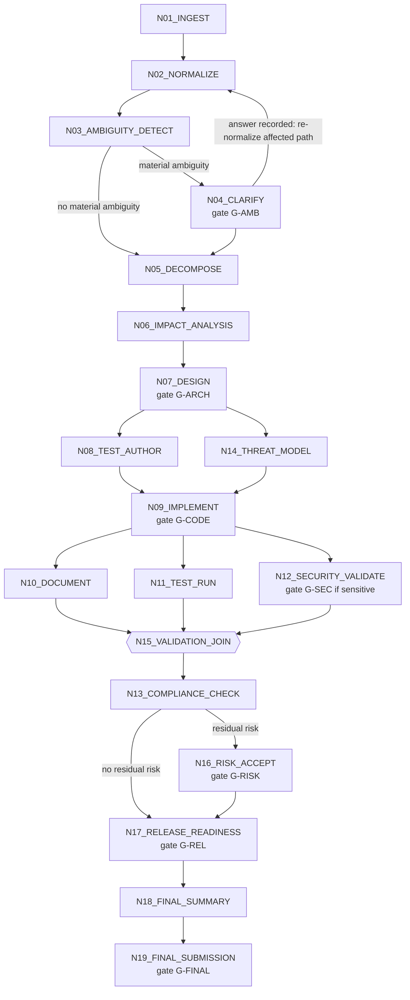

# Agentic Orchestration Model

**Feature**: `001-agentic-sdlc-url-shortener` | **Spec**: [spec.md](spec.md) v1.11 | **Plan**: [plan.md](plan.md) | **Data**: [data-model.md](data-model.md)

Design only. This is the control plane's explicit, stateful, non-linear model (FR-103 to FR-123, FR-133). It is not a sequence of agents: stage order comes from a dependency graph, parallel branches fan out and synchronize, conditional branches skip with a recorded reason, human gates block paths, and replanning creates a new plan version instead of editing history.

## 1. Model Overview

| Concept | Definition |
|---------|------------|
| **Workflow profile** | A named, versioned definition (`sdlc/1`): the node catalogue, the edges, the gates, and the condition predicates. Scenario runs use this profile. |
| **Run** | One execution (`workflow_runs`). Its `run_id` is the correlation identifier. |
| **Plan version** | An immutable graph instance for a run. A replan creates version n+1; old versions stay for lineage (FR-122, FR-108). |
| **Node** | A stage with inputs, outputs, entry and exit criteria, owner, and failure behavior (FR-104). |
| **Edge** | `DEPENDS_ON` (must be SUCCEEDED or SKIPPED), `CONDITIONAL` (a named predicate), or `GATE` (a human decision). |
| **Attempt** | One execution of a node instance, with its own lease, outcome, and input hash. |
| **Artifact version** | An immutable output. Consumption edges record which versions each node used; staleness and replanning follow them. |
| **Gate** | A human approval point (section 6). Only the approver credential may decide (DEC-037). |
| **Effect** | A recorded side effect with its reversibility (rollback or compensate-only). |

The engine is a single in-process scheduler over PostgreSQL (ADR-003, ADR-004). Every state change commits atomically with its artifact versions, effects, and audit events (data-model.md section 3.3).

## 2. Workflow Graph (`sdlc/1`)



**Fan-out by decomposition (branches).** N05 declares independent task groups called *branches*, with dependency edges between branches where they exist. The engine instantiates N08, N09, N10, and N11 once per branch (the instance key is `node_key` plus `branch`, written `N09_IMPLEMENT:capture`). N12, N13, N14, N15 and later nodes are run-level (one instance); N12 depends on every N09 branch instance, and N15 on every N10 and N11 instance and N12. This is what makes "suspend only the affected path" (FR-113) precise: a material ambiguity found inside one branch suspends that branch's instances, while other branches and run-level work that does not depend on it keep running.

Properties demonstrated:

- **Sequential paths**: N01 to N07.
- **Fan-out**: N07 to {N08, N14}, then N09 to {N10, N11, N12}.
- **Synchronization**: N09 waits for N08 and N14; N15 waits for N10, N11, N12.
- **Conditional branches**: N04 (material ambiguity), N16 (residual risk), G-SEC (security-sensitive change), G-DESTR (destructive effect), skipped implementation when N06 finds nothing to change.
- **Loops by replan, not by edge**: N04's answer re-enters N02 through a new plan version, never by mutating the graph.

Scenario C run with "no change required" skips N07 to N12 (section 7.3) with recorded reasons.

## 3. Node States and Transitions

### 3.1 States

| State | Meaning |
|-------|---------|
| `PENDING` | Dependencies not yet satisfied. |
| `READY` | Dependencies satisfied, entry criteria true, pre-execution policy hooks passed. |
| `RUNNING` | An attempt holds a lease. |
| `AWAITING_WORK` | An agent work item is offered or claimed. |
| `RETRY_WAIT` | A transient failure occurred and retries remain; waiting out the backoff. |
| `AWAITING_APPROVAL` | Execution finished; the exit gate is open. |
| `SUSPENDED` | Held by a material ambiguity or a human rejection; resumes only through a recorded decision. |
| `SUCCEEDED` | Exit criteria met (and any exit gate approved). |
| `FAILED_PERMANENT` | A permanent failure, or retries and fallback exhausted. |
| `FALLBACK_ACTIVE` | Retries exhausted and a defined fallback is running. |
| `COMPENSATING` | Compensation actions in progress for committed effects. |
| `COMPENSATED` | Compensation complete. |
| `STALE` | An input artifact version was superseded; this instance is kept for lineage and not re-run (a new instance exists in the new plan version). |
| `SKIPPED` | A conditional edge was false; the reason is recorded. |
| `CANCELLED` | The run was cancelled by the human. |

### 3.2 Allowed transitions (common to all node types)

| From | To | Guard | Audit action |
|------|----|-------|--------------|
| PENDING | READY | All `DEPENDS_ON` nodes SUCCEEDED or SKIPPED; entry criteria true; policy hooks PASS (or covered by an approved exception) | `NODE_STATE_CHANGED` |
| PENDING | SKIPPED | A conditional predicate is false | `NODE_STATE_CHANGED` with skip reason |
| PENDING | SUSPENDED | A material ambiguity affects this path (FR-113) | `NODE_STATE_CHANGED` |
| READY | RUNNING | Attempt created with lease and idempotency key | `ATTEMPT_STARTED` |
| RUNNING | AWAITING_WORK | Agent node: work item offered | `WORK_ITEM_OFFERED` |
| RUNNING or AWAITING_WORK | AWAITING_APPROVAL | Output valid and an exit gate defined | `APPROVAL_REQUESTED` |
| RUNNING or AWAITING_WORK | SUCCEEDED | Output valid, exit criteria met, no exit gate | `ATTEMPT_FINISHED` |
| AWAITING_APPROVAL | SUCCEEDED | Approver credential, decision APPROVE, subject hash current | `APPROVAL_RECORDED` |
| AWAITING_APPROVAL | SUSPENDED | Decision REJECT | `APPROVAL_RECORDED` and `REPLAN_PROPOSED` (FR-116) |
| RUNNING or AWAITING_WORK | RETRY_WAIT | Transient failure and retries remain | `RETRY_SCHEDULED` |
| RETRY_WAIT | RUNNING | Backoff elapsed on the clock | `ATTEMPT_STARTED` |
| RUNNING or RETRY_WAIT | FALLBACK_ACTIVE | Retry bound reached and a fallback is defined | `FALLBACK_APPLIED` |
| FALLBACK_ACTIVE | SUCCEEDED, AWAITING_APPROVAL, or FAILED_PERMANENT | Fallback outcome | as above |
| RUNNING, AWAITING_WORK, FALLBACK_ACTIVE | FAILED_PERMANENT | Permanent failure, or no retries and no fallback | `ATTEMPT_FINISHED` with failure class |
| FAILED_PERMANENT, or any node with committed effects when the run aborts | COMPENSATING | Compensate-only effects exist | `COMPENSATION_STARTED` |
| COMPENSATING | COMPENSATED | All compensations done | `COMPENSATION_FINISHED` |
| any non-terminal | STALE | Consumed artifact version superseded in a replan | `ARTIFACT_MARKED_STALE` |
| any non-terminal | CANCELLED | Human cancels the run | `RUN_TERMINATED` |

### 3.3 Prohibited transitions

| Prohibited | Why |
|------------|-----|
| SUCCEEDED to RUNNING (re-execution of a succeeded instance) | Re-runs only happen as new instances in a new plan version (FR-122: do not re-run unaffected stages) |
| STALE to SUCCEEDED or RUNNING | A stale instance is history |
| PENDING or READY to RUNNING with an unsatisfied dependency or an open gate | FR-106 NAC |
| AWAITING_APPROVAL to SUCCEEDED without an approval by the approver credential whose subject hash equals the current hash | DEC-037, FR-123 |
| Any gate decision from AGENT or READER credentials | DEC-037, FR-109 |
| RETRY_WAIT beyond the retry bound | FR-117 NAC |
| FAILED_PERMANENT to anything except COMPENSATING | Deterministic terminal outcomes |
| Any transition on a node of a terminal run | DEC-050 |
| Editing a plan version's graph | Plans are immutable; replan creates a new version |
| Direct state edits outside the engine API | FR-104 NAC |

Each prohibited transition has a test (orchestration transition tests, [testing-strategy.md](testing-strategy.md)).

## 4. Node Defaults by Type

Per-node blocks (section 8) state the node-specific values and inherit these type defaults. Values marked PA are plan proposals (research.md section 5) and PVT are approved targets.

| Type | Nodes | Timeout per attempt | Retry policy | Failure classification | Default fallback |
|------|-------|---------------------|--------------|------------------------|------------------|
| **T-DET** (deterministic system node) | N01, N03, N11, N15, N17, N18 | 10 s (PA-002, PVT-010) | Up to 3 retries (PVT-009) after the first attempt, exponential backoff 1 s, 2 s, 4 s with no jitter in the prototype (PVT-010) | Transient: persistence busy or timeout, interrupted process. Permanent: invariant violation, schema-invalid input, unmet precondition (a defect, not a retry candidate). | None |
| **T-AGENT** (agent work node) | N02, N05, N06, N07, N08, N09, N10, N12, N14 | 60 minutes logical per work item attempt (PA-002) | Same bounds. A rejected or schema-invalid submission is transient (the agent may resubmit with feedback). | Transient: timeout, lease expiry, schema-invalid submission, failed validation tests. Permanent: submission outside the agent scope, fabricated evidence (POL-TRC-002), repeated identical failure. | `HUMAN_AUTHORED_SUBMISSION`: the human candidate authors the artifact via the approver credential; it passes the same gates (never lowers a requirement, FR-118). In `SCRIPTED` runs, `ALTERNATE_SCRIPTED_AGENT`. |
| **T-EVAL** (policy evaluation) | N13 | 10 s per policy check | As T-DET | Check function error is transient once, then permanent; a FAIL outcome is a result, not a failure | None |
| **T-GATE** (human gate on a node's exit) | G-* | 24 hours logical, then ESCALATED, then 24 hours logical, then safe-stop (PVT-008); simulated in tests and labelled "simulated 24-hour timeout" (DEC-044) | None (a human wait is not a failure) | Timeout is not a failure and not an approval | None |

Backoff, timeouts, and the simulated clock use the `Clock` port (ADR-010). Every transient failure writes a `failure_events` row (the MTTR source).

## 5. Run States and Terminal Outcomes

```text
CREATED --first node scheduled--> RUNNING
RUNNING --all required nodes succeeded or skipped--> COMPLETED (release_outcome READY or NOT_READY)
RUNNING --safe-stop trigger--> SAFE_STOPPED   (terminal, permanent, never resumed: DEC-050)
RUNNING --human cancels--> CANCELLED          (terminal)
```

- A `NOT_READY` determination is a correct governed outcome: the run still completes (FR-128). It is reported separately from system failures in the measurements.
- `SAFE_STOPPED` is terminal for that run. Recovery requires the human to explicitly start a new run, optionally linking `parent_run_id` (DEC-050). The stopped run is never modified and remains `SAFE_STOPPED` in the audit log.

### 5.1 Safe-stop triggers (FR-120)

| ID | Trigger | Behavior |
|----|---------|----------|
| SS-1 | A required node reaches FAILED_PERMANENT (permanent failure, or retries and fallback exhausted) | In-flight sibling branches drain to a safe boundary; no dependents start; committed compensate-only effects of the failed branch are compensated; then safe-stop |
| SS-2 | A compensation fails (`COMPENSATION_FAILED`) | Escalate and safe-stop immediately; the failure is recorded as UNRECOVERED |
| SS-3 | A gate times out twice (24 h logical, escalated, 24 h logical) | Safe-stop (FR-115, PVT-008) |
| SS-4 | A mandatory policy FAIL stays unresolved at the end of the 24-hour (logical) policy-block window (DEC-045) | Safe-stop |
| SS-5 | Audit hash-chain verification fails for the run | Safe-stop (integrity cannot be trusted) |
| SS-6 | More than 3 resumptions of one node (PA-003) | Safe-stop |
| SS-7 | The control-plane persistence layer stays unavailable beyond the retry bound while a state change is pending | Safe-stop is recorded when persistence returns; the run is quarantined in the meantime |

Safe-stop preserves all state and evidence (FR-120 NAC). A response arriving later at a gate of a safe-stopped run is rejected, logged as `late_response_after_safe_stop`, and leaves the run SAFE_STOPPED (DEC-041).

## 6. Human Gates

All gates accept decisions only with the approver credential (DEC-037). A decision binds to the hash of the content reviewed; if the content has since changed, the decision is rejected with `approval_subject_changed`. Timeouts follow T-GATE. "Escalate" with a single human authority means: record the escalation, extend the deadline once, and keep the gate open (there is no second approver); the second timeout leads to safe-stop (ASM-003, PVT-008).

| Gate | Trigger | Subject | On approve | On reject | On timeout |
|------|---------|---------|------------|-----------|------------|
| **G-AMB** unresolved ambiguity | N03 finds a material ambiguity (DEC-047) | The clarification question and options | Record decision, run impact analysis, replan, resume at N02 | Requirement marked rejected; run proposes a replan or cancellation | Escalate, then safe-stop |
| **G-ARCH** architecture approval | Exit of N07 | Design, API contract delta, ADR set | N08 and N14 become READY | SUSPENDED plus replan proposal | Escalate, then safe-stop |
| **G-CODE** human review of AI-generated artifacts (FR-133) | Exit of N09 | Code change and tests (the artifacts generated by AI) | Artifacts become merge-eligible and complete | SUSPENDED plus replan proposal | Escalate, then safe-stop |
| **G-SEC** security-sensitive action | Predicate `security_sensitive_change` (changes touching URL validation, rate limiting, credentials, audit, or secrets) or a high or critical scan finding | The change and the findings | Proceed, or the finding is covered by an exception through G-EXC | SUSPENDED plus replan | Escalate, then safe-stop |
| **G-DESTR** destructive or irreversible action | Predicate `has_destructive_effect`: schema element drop or rename, data deletion, history rewrite, merge to a protected branch, any external send | The exact action and its compensation plan | The effect is allowed and recorded as COMPENSATE_ONLY | The action is removed from the plan | Escalate, then safe-stop |
| **G-EXC** constitutional exception | A policy exception is proposed (never for non-waivable policies) | The exception record (policy, reason, scope, compensating control, expiry or review condition) | Exception APPROVED with approver identity and timestamp | Exception REJECTED; the FAIL stands and blocks | Escalate, then safe-stop (the FAIL stays) |
| **G-RISK** material risk acceptance | N13 leaves residual risk or accepted limitation items above "low" | The risk register | Risks accepted and disclosed in the summary | The release readiness cannot be READY on that risk | Escalate, then safe-stop |
| **G-REL** release readiness | Exit of N17 | The readiness report | The determination stands as the human-declared outcome (Governance: only the human declares release readiness) | The determination is recorded as not accepted | Escalate, then safe-stop |
| **G-FINAL** final submission | Exit of N19 | The final summary and evidence index | Submission recorded | Not submitted; the run still completes | Escalate, then safe-stop |
| **G-CHG** change approval | A change to an approved requirement, architecture, schema, workflow state, security control, or release criterion (DEC-046), including a replan proposal after a rejection | The impact analysis and change record | Replan applied; affected approvals superseded | Change not applied | Escalate, then safe-stop |

## 7. Replanning, Recovery, and Compensation

### 7.1 Dynamic replanning (FR-122, FR-123)

Triggers: a new version of an artifact that downstream instances consumed (for example a clarified requirement), a G-AMB answer, a G-CHG approval, or a rejection at any gate.

Algorithm (one transaction per plan version):

1. **Affected set**: from `artifact_consumptions`, find every instance in the current plan that consumed a slice (or an unsliced version) whose hash differs in the new version, plus the transitive closure through the artifacts those instances produced. Consumers of unchanged slices are not affected.
2. **Materiality** (DEC-046): classify the changed artifact version by its `materiality_kind` (requirement, architecture, schema, workflow state, security control, release criterion are material; everything else is not).
3. **Approvals**: for a material change, mark every gate whose subject hash changed `SUPERSEDED`, so re-approval is required. Approvals on unchanged content remain valid. A non-material change never invalidates an approval.
4. **New plan version n+1**: copy all unaffected SUCCEEDED instances as carried over (not re-run); mark affected old instances `STALE`; create fresh `PENDING` instances for the affected nodes; edges are recomputed from the profile.
5. **Governance on the new plan**: policy evaluation at `ON_REPLAN`; a material change opens G-CHG; gates re-apply to the new instances (no bypass, FR-123).
6. **Audit**: `REPLAN_PROPOSED`, then `REPLAN_APPLIED` with the affected set, the reason, and both plan versions.

Unaffected completed stages are not re-run without cause (FR-122 NAC); the test proves that the set of instances executed after a replan equals the computed affected set.

### 7.2 Resume and recovery (FR-107, FR-121, NFR-008)

On startup, and on a human `resume` request:

1. Load persisted state; verify each active run's audit hash chain (failure leads to SS-5).
2. For every `RUNNING` attempt whose lease has expired: mark the attempt `INTERRUPTED`, create a `failure_events` row (source `PROCESS_INTERRUPTION` or `LEASE_EXPIRY`, detected now), and return the node to `READY` (the interruption does not consume a retry, but increments `resumption_count`; more than 3 leads to SS-6).
3. Before re-executing, consult the **effect ledger**: an effect already COMMITTED for the same idempotency key (`run_id + node_key + plan_version + input_hash`) is not repeated; the attempt adopts the recorded result (no duplicated completed side effects).
4. Reopen `AWAITING_WORK` work items whose leases expired; keep claimed leases that remain valid.
5. When the re-execution succeeds, complete the failure event (recovery mechanism `RESUME`).
6. A SAFE_STOPPED or other terminal run is never touched (DEC-050).

### 7.3 Rollback versus compensation (FR-119, ASM-014, DEC-056)

| Effect kind | Reversibility | Mechanism |
|-------------|---------------|-----------|
| `DB_WRITE`, `ARTIFACT_WRITE` inside a unit of work | ROLLBACK | Abort the transaction; nothing becomes visible. This is primary for the prototype. |
| `AUDIT_RECORD` | COMPENSATE_ONLY | Never deleted; a compensating audit event explains the reversal. |
| `APPROVAL_RECORD` | COMPENSATE_ONLY | Never deleted; a later REJECT, supersession, or revocation compensates. |
| `CODE_COMMIT` (a commit on a working branch) | COMPENSATE_ONLY | A revert commit. Merge to a protected branch additionally needs G-DESTR. |
| `EXTERNAL_SEND` (any message or call leaving the system) | COMPENSATE_ONLY | A follow-up correction where one exists; otherwise the action needs G-DESTR first. |

An effect is registered `INTENDED` before it happens and `COMMITTED` after. On failure after partial effects, ROLLBACK effects are aborted and COMPENSATE_ONLY effects run their compensation in reverse commit order. A failed compensation triggers SS-2.

### 7.4 Retries, fallback, and idempotent execution (FR-117, FR-118)

- A node attempt's idempotency key is `run_id + node_key + plan_version + input_hash`. A duplicate dispatch of the same key adopts the existing attempt (duplicate execution protection).
- Retries apply only to transient failures, within the bound, never repeating a COMMITTED non-idempotent effect (FR-117 NAC).
- Fallback is attempted only after the retry bound, is recorded, and never lowers a policy, security, or approval requirement (FR-118 NAC). If no fallback exists, the node is FAILED_PERMANENT.

## 8. Node Catalogue

All nodes inherit section 4 defaults and the section 3 transitions. "Prohibited" lists node-specific prohibitions in addition to section 3.3. Audit events listed are in addition to the generic `NODE_STATE_CHANGED`, `ATTEMPT_STARTED`, `ATTEMPT_FINISHED`.

### N01_INGEST

- **Purpose**: Accept the requirement text and create the requirement record (FR-101, FR-110).
- **Type and actor**: T-DET, SYSTEM (submitted by the human via the approver credential).
- **Inputs**: raw requirement text, profile, scenario tag.
- **Outputs**: `requirement-raw` artifact version; `requirements` row.
- **Preconditions**: run CREATED; text non-empty and within 20 000 characters.
- **Postconditions**: requirement stored with hash; policy catalogue version recorded.
- **Allowed transitions**: generic.
- **Prohibited**: modifying the raw text after ingestion (new versions only).
- **Timeout / retry / failure classification / fallback**: T-DET defaults. Empty or oversized text is a permanent failure that rejects run creation before any node starts.
- **Audit events**: `RUN_CREATED`, `REQUIREMENT_INGESTED`.

### N02_NORMALIZE

- **Purpose**: Normalize the requirement into a structured, testable form and record the requirement-quality checks (FR-110, FR-112).
- **Type and actor**: T-AGENT, role requirements-analyst.
- **Inputs**: `requirement-raw`; on re-entry, the clarification decision.
- **Outputs**: `normalized-requirement` (materiality kind REQUIREMENT) with `quality_checks` (complete, consistent, testable, in policy and architecture boundaries) and `touches` tags (API_CONTRACT, PERSISTENCE_SCHEMA, SECURITY_BOUNDARY, ORCHESTRATION_FLOW).
- **Preconditions**: N01 SUCCEEDED; no open G-AMB on this path.
- **Postconditions**: every statement is either testable or flagged; no requirement invented absent from the input (FR-110 NAC); policy hook `AFTER_NORMALIZE` evaluated.
- **Allowed transitions**: generic; re-entered as a new instance after G-AMB.
- **Prohibited**: resolving a material ambiguity silently.
- **Timeout / retry / failure classification / fallback**: T-AGENT defaults; an output that invents requirements is a permanent failure.
- **Audit events**: `ARTIFACT_VERSION_CREATED`, `POLICY_EVALUATED`.

### N03_AMBIGUITY_DETECT

- **Purpose**: Detect incomplete, unclear, or conflicting content and classify it material or non-material (FR-111, DEC-047).
- **Type and actor**: T-DET (rule-based), SYSTEM.
- **Inputs**: `normalized-requirement`.
- **Outputs**: `ambiguity-report`; `ambiguities` rows with `criteria_matched`; for a clean requirement, a recorded "clarification not required" reason with the checks performed (FR-112).
- **Preconditions**: N02 SUCCEEDED.
- **Postconditions**: each flagged item classified. An ambiguity is MATERIAL if resolving it differently would change the API contract, persistence schema, security boundary, or orchestration flow (judged through the `touches` tags and conflict rules); otherwise NON_MATERIAL with a safe, documented default applied.
- **Allowed transitions**: generic; SKIPS N04 when none is material, recording why.
- **Prohibited**: creating an artificial clarification gate for a clean requirement (FR-112 NAC).
- **Failure classification**: T-DET defaults.
- **Audit events**: `AMBIGUITY_DETECTED` (one per item), `DECISION_RECORDED` (for applied defaults).

### N04_CLARIFY

- **Purpose**: Obtain a human decision on a material ambiguity, suspending only the affected path (FR-113).
- **Type and actor**: T-GATE (G-AMB), HUMAN approver.
- **Inputs**: material ambiguities, options.
- **Outputs**: `clarification-decision`; a `decisions` row; an impact analysis seed.
- **Preconditions**: at least one MATERIAL ambiguity.
- **Postconditions**: the decision is recorded; affected nodes are identified; the plan is replanned to resume at N02.
- **Allowed transitions**: generic gate transitions; unaffected branches continue to run.
- **Prohibited**: IMPLEMENT (N09) starting on the affected path while the ambiguity is unresolved (FR-113 NAC; entry criteria check).
- **Timeout**: 24 h logical, escalate, 24 h, safe-stop; a late response is rejected (DEC-041).
- **Retry / fallback**: none.
- **Audit events**: `CLARIFICATION_REQUESTED`, `CLARIFICATION_ANSWERED`, `DECISION_RECORDED`, `REPLAN_APPLIED`, `APPROVAL_TIMEOUT`, `APPROVAL_ESCALATED`, `LATE_RESPONSE_REJECTED`.

### N05_DECOMPOSE

- **Purpose**: Decompose the normalized requirement into traceable tasks with dependencies.
- **Type and actor**: T-AGENT, requirements-analyst.
- **Inputs**: `normalized-requirement`, `ambiguity-report`, clarification decision if any.
- **Outputs**: `task-decomposition` (tasks, acceptance criteria per task, dependency edges, requirement ids).
- **Preconditions**: no open material ambiguity on the path.
- **Postconditions**: every task cites a requirement id; dependencies form a DAG.
- **Prohibited**: a task without acceptance criteria.
- **Timeout / retry / failure classification / fallback**: T-AGENT defaults; a cyclic dependency is a permanent failure.
- **Audit events**: `ARTIFACT_VERSION_CREATED`.

### N06_IMPACT_ANALYSIS

- **Purpose**: Greenfield: record the API and schema impacts. Brownfield: identify impacted components, interfaces, data flows, tests, documentation, regression risks, and rollout or rollback considerations before any code change (SCN-B; FR-126).
- **Type and actor**: T-AGENT, requirements-analyst (with deterministic repository inspection).
- **Inputs**: `task-decomposition`, the baseline repository state and contracts.
- **Outputs**: `impact-analysis` (materiality kind SCHEMA when contracts or schema change); `change_requests` row when an approved item changes.
- **Preconditions**: N05 SUCCEEDED.
- **Postconditions**: all seven impact categories are filled or explicitly "none"; `has_destructive_effect` and `security_sensitive_change` predicates computed; if nothing is impacted, downstream implementation nodes are SKIPPED with the reason.
- **Prohibited**: starting N09 while the analysis is incomplete (SCN-B scenario 2).
- **Failure classification**: T-AGENT defaults.
- **Audit events**: `ARTIFACT_VERSION_CREATED`, `CHANGE_REQUESTED` (when applicable), `POLICY_EVALUATED` (`ON_CHANGE`).

### N07_DESIGN

- **Purpose**: Produce the architecture and design for the tasks, including the API contract delta and the ADRs for material decisions (Constitution VII).
- **Type and actor**: T-AGENT, designer; exit gate G-ARCH.
- **Inputs**: `task-decomposition`, `impact-analysis`.
- **Outputs**: `design-doc` (ARCHITECTURE), `api-contract-delta` (SCHEMA), ADR set.
- **Preconditions**: N06 SUCCEEDED.
- **Postconditions**: the contract delta passes the compatibility check; material decisions have recorded alternatives (POL-ARCH-002); policy hook `AFTER_DESIGN`.
- **Prohibited**: leaving the node SUCCEEDED without an approver decision at G-ARCH.
- **Timeout**: agent attempt 60 min logical; gate per T-GATE.
- **Failure classification / fallback**: T-AGENT defaults.
- **Audit events**: `ARTIFACT_VERSION_CREATED`, `APPROVAL_REQUESTED`, `APPROVAL_RECORDED`, `POLICY_EVALUATED`.

### N08_TEST_AUTHOR

- **Purpose**: Author the failing tests from the acceptance criteria (the red step, Constitution IV).
- **Type and actor**: T-AGENT, test-author.
- **Inputs**: `task-decomposition`, `design-doc`, `api-contract-delta`.
- **Outputs**: `test-suite` (OTHER) and a recorded red run showing each new test failing for the expected reason.
- **Preconditions**: G-ARCH approved.
- **Postconditions**: every acceptance criterion has at least one test; red evidence is attached (POL-TEST-001).
- **Prohibited**: producing production code.
- **Failure classification / fallback**: T-AGENT defaults; tests that pass before implementation exist (not red) are rejected as a transient failure with feedback.
- **Audit events**: `WORK_ITEM_OFFERED`, `WORK_ITEM_SUBMITTED`, `ARTIFACT_VERSION_CREATED`.

### N14_THREAT_MODEL

- **Purpose**: Review threat scenarios for the design and produce mitigations (FR-127, Constitution V).
- **Type and actor**: T-AGENT, security-reviewer; runs in parallel with N08.
- **Inputs**: `design-doc`, `api-contract-delta`.
- **Outputs**: `threat-model` (SECURITY_CONTROL), mitigation list consumed by N09.
- **Preconditions**: G-ARCH approved.
- **Postconditions**: each abuse case from [security.md](security.md) relevant to the change has a mitigation or an accepted risk.
- **Prohibited**: marking complete without covering the relevant abuse cases.
- **Failure classification / fallback**: T-AGENT defaults.
- **Audit events**: `ARTIFACT_VERSION_CREATED`.

### N09_IMPLEMENT

- **Purpose**: Implement the minimum behavior that makes the failing tests pass, then refactor with tests green (Constitution IV); governed by FR-133.
- **Type and actor**: T-AGENT, implementer; exit gate G-CODE.
- **Inputs**: `test-suite`, `threat-model`, `design-doc`.
- **Outputs**: `code-change` (a patch applied to a working branch only after G-CODE; materiality SECURITY_CONTROL when it touches security-control paths); a green run; refactor evidence.
- **Preconditions**: N08 and N14 SUCCEEDED (synchronization); impact analysis complete; no unresolved material ambiguity on this path.
- **Postconditions**: the new tests pass and the regression suite passes; red-before-green evidence is linked; G-CODE approved for all generated code and tests.
- **Allowed transitions**: generic. Applying the patch to the repository is a registered `CODE_COMMIT` effect, COMPENSATE_ONLY (revert).
- **Prohibited**: committing before G-CODE approval; merging to a protected branch (human only, G-DESTR); deploying anything (FR-133).
- **Timeout / retry**: T-AGENT; the failing validation tests are a transient failure up to the bound.
- **Failure classification / fallback**: T-AGENT defaults; compensation: revert commit.
- **Audit events**: `WORK_ITEM_SUBMITTED`, `ARTIFACT_VERSION_CREATED`, `APPROVAL_REQUESTED`, `APPROVAL_RECORDED`, `COMPENSATION_STARTED` and `COMPENSATION_FINISHED` when reverted.

### N10_DOCUMENT

- **Purpose**: Produce or update documentation (API docs, runbook, change notes) for the implemented change (POL-TRC-004).
- **Type and actor**: T-AGENT, documenter.
- **Inputs**: `code-change`, `design-doc`, contract files.
- **Outputs**: `docs` artifact (OTHER).
- **Preconditions**: N09 SUCCEEDED.
- **Postconditions**: documentation consistent with the contract; examples validate against schemas (CV-03).
- **Prohibited**: documenting behavior that no test demonstrates.
- **Failure classification / fallback**: T-AGENT defaults.
- **Audit events**: `ARTIFACT_VERSION_CREATED`.

### N11_TEST_RUN

- **Purpose**: Execute the test suites and record the results (unit, contract, integration, concurrency, reliability, security, end to end as applicable).
- **Type and actor**: T-DET, SYSTEM; runs in parallel with N10 and N12.
- **Inputs**: `code-change`, `test-suite`.
- **Outputs**: `test-report` (OTHER) with per-requirement execution status; coverage figure labelled demonstration.
- **Preconditions**: N09 SUCCEEDED.
- **Postconditions**: results are real execution output with environment and time; failures are recorded, never hidden.
- **Timeout**: the suite timeout is configured (default 10 minutes), an exception to the 10-second T-DET default recorded as PA-002.
- **Retry / failure classification**: a test failure is a result (NOT_READY contributor), not a node failure; infrastructure errors are transient.
- **Fallback**: none.
- **Audit events**: `ARTIFACT_VERSION_CREATED`, `POLICY_EVALUATED` (`AFTER_TEST`).

### N12_SECURITY_VALIDATE

- **Purpose**: Run dependency scanning, secret scanning, and license checks, and review findings (FR-127).
- **Type and actor**: T-AGENT (reviewer) over deterministic scans executed by SYSTEM; gate G-SEC when sensitive or findings.
- **Inputs**: `code-change`, `threat-model`, dependency lock file.
- **Outputs**: `security-report` (scan outputs as evidence, findings with severities).
- **Preconditions**: N09 SUCCEEDED.
- **Postconditions**: scans executed (a clean result carries the scan evidence); unresolved high or critical findings fail POL-SEC-005 (DEC-054).
- **Prohibited**: completing without running the scans (FR-127 NAC).
- **Failure classification**: scanner unavailable offline is transient; the offline condition is recorded in the evidence.
- **Audit events**: `ARTIFACT_VERSION_CREATED`, `POLICY_EVALUATED`, `APPROVAL_REQUESTED` (G-SEC).

### N15_VALIDATION_JOIN

- **Purpose**: Synchronize the parallel branches (FR-106).
- **Type and actor**: T-DET, SYSTEM.
- **Inputs**: N10, N11, N12 outputs.
- **Outputs**: `validation-summary`.
- **Preconditions**: N10, N11, N12 each SUCCEEDED or SKIPPED with reason.
- **Postconditions**: the summary lists each branch outcome.
- **Prohibited**: starting before every dependency completes.
- **Failure classification / fallback**: T-DET defaults.
- **Audit events**: `NODE_STATE_CHANGED` only.

### N13_COMPLIANCE_CHECK

- **Purpose**: The compliance-check stage: evaluate the whole mandatory policy set for the run (FR-124, FR-125).
- **Type and actor**: T-EVAL, SYSTEM.
- **Inputs**: all run artifacts, evidence, the policy catalogue.
- **Outputs**: `policy-evaluation-set`; `policy_evaluations` rows, exactly one outcome per applicable policy per evaluation point.
- **Preconditions**: N15 SUCCEEDED.
- **Postconditions**: a mandatory FAIL blocks every downstream node until resolved or covered by an approved exception (FR-125); if unresolved at the policy-block window end, SS-4.
- **Prohibited**: a check ending without an outcome (FR-124 NAC); an agent approving an exception.
- **Failure classification**: a check function error is retried once as transient.
- **Audit events**: `POLICY_EVALUATED`, `EXCEPTION_REQUESTED`, `EXCEPTION_DECIDED`.

### N16_RISK_ACCEPT

- **Purpose**: Obtain human acceptance of residual risks and accepted limitations (material risk acceptance).
- **Type and actor**: T-GATE (G-RISK), HUMAN approver; conditional on `has_residual_risk`.
- **Inputs**: risk register, limitations (LIM-001 to LIM-003 as applicable).
- **Outputs**: `risk-acceptance` decision.
- **Preconditions**: N13 SUCCEEDED.
- **Postconditions**: accepted risks are listed for the final summary.
- **Prohibited**: implicit acceptance by silence (DEC-041, FR-114).
- **Timeout**: T-GATE.
- **Audit events**: `APPROVAL_REQUESTED`, `APPROVAL_RECORDED`, `DECISION_RECORDED`.

### N17_RELEASE_READINESS

- **Purpose**: Determine READY or NOT_READY deterministically and record the human-declared outcome (FR-128, ASM-013).
- **Type and actor**: T-DET computation (SYSTEM) then gate G-REL (HUMAN release owner role).
- **Inputs**: policy evaluations, exceptions, test report, approvals, residual risks.
- **Outputs**: `readiness-report` (RELEASE_CRITERION) with `outcome` and `blocking_items`.
- **Preconditions**: N13 and, if applicable, N16 SUCCEEDED.
- **Postconditions**: READY only if all mandatory policy checks PASS, zero unapproved exceptions, tests executed for all functional requirements, and the release-owner approval exists; otherwise NOT_READY with every blocking item cited. The same inputs always give the same outcome.
- **Prohibited**: READY with a mandatory FAIL, an unapproved or expired exception, missing test evidence, or a missing release-owner approval.
- **Audit events**: `RELEASE_READINESS_DETERMINED`, `APPROVAL_REQUESTED`, `APPROVAL_RECORDED`.

### N18_FINAL_SUMMARY

- **Purpose**: Produce the final engineering summary (FR-129).
- **Type and actor**: T-DET, SYSTEM (assembled from recorded evidence).
- **Inputs**: all artifacts, decisions, measurements.
- **Outputs**: `final-summary` listing what was built, decisions, deviations, results, residual risks, and evidence links, with the evidence mode of each item.
- **Preconditions**: N17 SUCCEEDED.
- **Postconditions**: every claim links to recorded evidence; demonstration data is labelled (FR-129 NAC).
- **Prohibited**: stating a result with no recorded evidence.
- **Audit events**: `ARTIFACT_VERSION_CREATED`.

### N19_FINAL_SUBMISSION

- **Purpose**: Record the human's final submission decision.
- **Type and actor**: T-GATE (G-FINAL), HUMAN approver.
- **Inputs**: `final-summary`, evidence index.
- **Outputs**: `submission-record`.
- **Preconditions**: N18 SUCCEEDED.
- **Postconditions**: a submission or a non-submission is recorded with reason; the run reaches COMPLETED.
- **Timeout**: T-GATE.
- **Audit events**: `APPROVAL_REQUESTED`, `APPROVAL_RECORDED`, `RUN_TERMINATED`.

## 9. Agent Contract (ASM-017)

The specification defines what the orchestrator expects from agents, not how they are invoked; the plan fixes the abstract interface (ADR-005).

### 9.1 `AgentPort` (abstract)

| Operation | Behavior |
|-----------|----------|
| `offer(work_package)` | The orchestrator writes a content-addressed work package (inputs, constraints, acceptance criteria, schema of the expected output, role) and creates a work item. |
| `claim(work_item)` | An agent claims it with a lease. |
| `submit(work_item, artifact, evidence)` | The agent submits an artifact conforming to the node's output schema and an idempotent content hash. |
| `release(work_item)` | The agent abandons it (recoverable). |

Adapters: **scripted** (deterministic fixtures, for tests and fault injection) and **external work** (file inbox and outbox, fulfilled by an AI-assisted session or a human). Both authenticate with the agent credential.

### 9.2 What the orchestrator expects and enforces

| Expectation | Enforcement |
|-------------|-------------|
| Output conforms to the node's output schema, with evidence references | Schema validation; non-conforming submissions are a transient failure with feedback |
| The agent declares assumptions and ambiguities it found, and never resolves a material one | N03 and policy POL-SPEC-004 |
| Agents never approve, grant exceptions, or hold the approver credential | 403 and `AGENT_ACTION_DENIED`; startup check refuses an agent worker whose environment contains the approver credential (ADR-007) |
| Each role acts only inside its permitted scope | Scope table below; out-of-scope actions are blocked and audited (FR-109) |
| Evidence is not fabricated; evidence carries `agent_mode` | POL-TRC-002 provenance check; SCRIPTED evidence can never be labelled LIVE_EXTERNAL |

### 9.3 Role scopes

| Role | May produce | May not |
|------|-------------|---------|
| requirements-analyst | N02, N05, N06 artifacts | Design, code, approvals |
| designer | N07 artifacts | Code, approvals |
| test-author | N08 tests | Production code, approvals |
| implementer | N09 code change | Merge, deploy, approvals, edit tests to force a pass without the test-author's artifact version changing through a recorded rework |
| documenter | N10 docs | Code, approvals |
| security-reviewer | N12 and N14 findings and mitigations | Waive findings (exceptions are human decisions) |

## 10. Condition Predicates (registry)

Predicates are named, pure, unit-tested functions; edges never contain free-form code.

| Predicate | True when |
|-----------|-----------|
| `has_material_ambiguity` | Any ambiguity classified MATERIAL (DEC-047) is OPEN |
| `is_brownfield` | The run targets an existing baseline (scenario tag SCN-B, or a change request) |
| `no_impacted_components` | N06 reports no impacted component, interface, data flow, test, or document |
| `security_sensitive_change` | The impact analysis touches URL validation, rate limiting, credentials, audit integrity, or secrets |
| `has_destructive_effect` | The plan includes a COMPENSATE_ONLY effect of a destructive kind (section 6, G-DESTR) |
| `has_residual_risk` | The risk register has items above "low" or accepted limitations apply |
| `has_failed_mandatory_policy` | Any mandatory evaluation outcome is FAIL without an approved exception |
