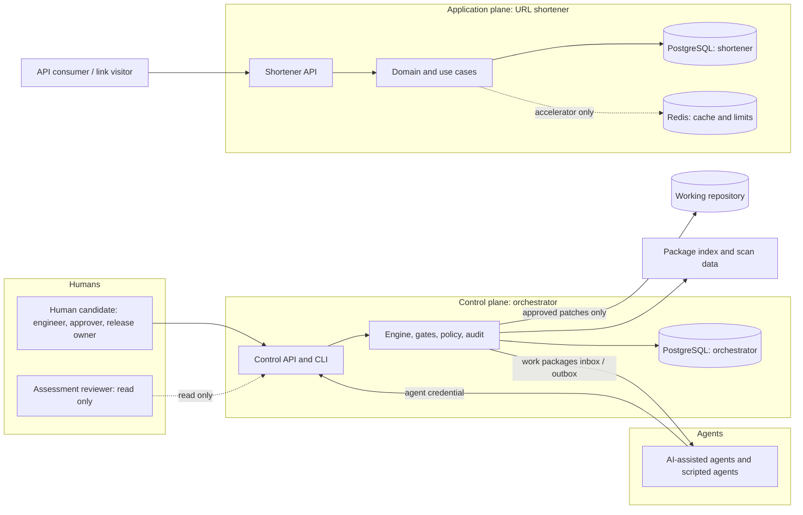

# Implementation Plan: Agentic SDLC Orchestration and URL Shortener

**Branch**: `001-agentic-sdlc-url-shortener` | **Date**: 2026-10-16 | **Spec**: [spec.md](spec.md) (Approved v1.12)

**Input**: Feature specification from `specs/001-agentic-sdlc-url-shortener/spec.md`

**Status**: **Approved v1.1** by the human candidate on 2026-10-16: PD-01 to PD-08 (DEC-059 to DEC-066), then PD-09 and PD-10 confirmed (DEC-067, DEC-068), the Docker, PostgreSQL, and Redis verification risk accepted (DEC-069), and PA-011 to PA-014 approved (DEC-070). **No confirmation is open.** No code has been written, and nothing in this plan is execution evidence unless it says "executed".

## Summary

Build a locally runnable, production-oriented prototype of two cooperating parts:

1. **Application plane**: a URL shortener service (create, validate, resolve, expire, analytics count, idempotency, rate limiting, health) specified by FR-001 to FR-023.
2. **Control plane**: a governed, stateful, non-linear orchestrator that runs a requirement through the SDLC (ingest, normalize, detect ambiguity, clarify, decompose, assess impact, design, test, implement, document, validate, comply, assess risk, determine release readiness, summarize, submit) with explicit dependencies, parallel branches, human gates, retries, fallback, compensation, safe-stop, resumption, dynamic replanning, an audit-grade evidence trail, policy enforcement, and MTTR and reliability measurements (FR-101 to FR-133).

Approach: the **approved stack** (DEC-060): **TypeScript on Node.js 20+, Fastify, PostgreSQL, Redis, Vitest with Supertest**, plus a small custom orchestration engine behind explicit ports and adapters, contract-first OpenAPI and JSON Schema (used at runtime by Fastify), a simulated-clock test strategy, a hash-chained audit log, three separate credentials so agents cannot approve, and a JSON policy catalogue that makes failed mandatory policies block release readiness. PostgreSQL is the source of truth; Redis accelerates rate limiting, replay lookups, and lease fast-failure but never decides an outcome (ADR-015). Three scenarios (greenfield, brownfield, ambiguous requirement) demonstrate the orchestration. The design avoids distributed-system complexity beyond that single database and cache: production-grade discipline, not production-scale infrastructure.

## Plan Documents

| Document | Content |
|----------|---------|
| [research.md](research.md) | Technology evaluation summary and feasibility evidence, plan assumptions PA-001 to PA-014 (background; the ADRs govern) |
| [docs/adr/](../../docs/adr/README.md) | **Architecture Decision Records ADR-001 to ADR-027: the authoritative source for decisions (DEC-106).** 24 Accepted (DEC-071 to DEC-094); ADR-003, ADR-014, and ADR-025 revised and awaiting re-approval |
| [data-model.md](data-model.md) | Persistence schemas for both planes, canonicalization rules, state machines, open design decisions OD-01 and OD-02 |
| [contracts/](contracts/README.md) | OpenAPI contracts for both planes, JSON Schemas, examples, policy catalogue draft, compatibility and change-control rules |
| [orchestration-model.md](orchestration-model.md) | Graph, node states, gates, replanning, recovery, compensation, agent contract, per-node definitions |
| [reliability.md](reliability.md) | Failure classes, retries, idempotency, fallback, safe-stop, fault-injection catalogue |
| [observability.md](observability.md) | Logs, metrics, traces, audit, measurements, MTTR definition |
| [security.md](security.md) | Threat model, abuse cases, secrets, trust boundaries, residual risks |
| [compliance-and-change-control.md](compliance-and-change-control.md) | Policy model, compliance stage, release blocking, exceptions, change requests |
| [testing-strategy.md](testing-strategy.md) | Test-first protocol, categories, tests-for-every-FR gate |
| [scenarios/](scenarios/scenario-a-greenfield.md) | Scenario A, B, and C designs |
| [traceability.md](traceability.md) | Traceability chain, mechanism, matrix seed |
| [quickstart.md](quickstart.md) | Target run and validation guide (not yet runnable) |

## Technical Context

**Language/Version**: TypeScript (strict), declared compatible with Node.js 20 or later, **tested on Node 22 (LTS)** (DEC-071; Node 22 is not installed here, the installed version is 24.22.0, so provisioning Node 22 is a CP-1 task); npm with a committed lock file; ES modules. *Approved, DEC-060, DEC-071, ADR-001.*

**Primary Dependencies**: Fastify 5 (approved). Companions (confirmed, DEC-070, PA-013): `pg`, `node-pg-migrate`, `ioredis`, `pino`, `prom-client`, `commander`, `uuid` (v7), `ajv` and `ajv-formats`, `@apidevtools/swagger-parser`; test and quality: Vitest and Supertest (approved), `fast-check`, `@vitest/coverage-v8`, ESLint with `typescript-eslint`, `tsc` strict; scans: `npm audit`, `secretlint`, `license-checker-rseidelsohn`. Installed together in a feasibility spike on Node 24.22.0 (research.md section 1.1).

**Storage**: PostgreSQL (approved), two databases (`shortener`, `orchestrator`) with one least-privilege role per plane, no ORM, numbered SQL migrations. Redis (approved) for rate limiting, the replay cache, and the advisory in-flight lock in the application plane only; PostgreSQL stays authoritative (ADR-015). *Not yet run on this machine: Docker was not running at the time of the check. Starting Docker and verifying PostgreSQL and Redis is a mandatory precondition for implementation (CP-1, DEC-069). With Redis down the service runs in PostgreSQL-only mode (DEC-067).*

**Testing**: Vitest with Supertest (approved); `fast-check` for canonicalization properties; requirement tags in test titles; a simulated `Clock` port; fault-injection hooks; a Supertest wrapper that validates every response against the contract. See testing-strategy.md.

**Target Platform**: Windows 11 (the candidate's machine) with Docker for local PostgreSQL and Redis; the design stays portable to Linux and macOS. Single node, loopback only (ASM-007). Containers are a local-development convenience, not a deployment platform (EXC-002).

**Project Type**: Two-plane service plus CLI (web-service and command-line) in one repository.

**Performance Goals**: The approved demonstration goals PVT-001 to PVT-005 (redirect p95 at most 100 ms, creation p95 at most 300 ms, 100 redirects per second, 10 creations per second) as demonstration data, never production measurements (DEC-013).

**Constraints**: 2 to 3 day timebox; no TLS (loopback); no GUI, deployment, billing, or rich analytics (EXC-001 to EXC-006); agents never hold the approver credential; no fabricated evidence.

**Scale/Scope**: One machine, one human approver, three scenarios, 56 functional requirements, 11 non-functional requirements, about 19 node types, 10 gate types.

**Unknowns**: none left as NEEDS CLARIFICATION; each is resolved by a proposed ADR (research.md section 0) pending approval.

## 1. System Context

### 1.1 Boundary and actors



| Actor | Role |
|-------|------|
| API consumer, link visitor | Anonymous users of the shortener (DEC-010) |
| Human candidate | Software engineer, human approver, release owner (one authority, ASM-003; roles recorded as strings, DEC-012) |
| Assessment reviewer | Read-only audit role (DEC-018) |
| Agents | AI-assisted sessions and scripted agents; bounded by role scope; never approve |

### 1.2 External dependencies

| Dependency | Use | Failure mode and handling |
|------------|-----|---------------------------|
| Package index and advisory data | Install and scans | Offline use is labelled OFFLINE in evidence; the human decides at G-SEC |
| PostgreSQL and Redis (local containers) | Source of truth for both planes; cache, rate limits, and in-flight lock for the application plane | PostgreSQL unavailable: the service reports not-ready and returns 503. Redis unavailable: PostgreSQL-only mode (PostgreSQL-based rate limiting, no replay cache, no advisory lock), service stays ready (DEC-067) |
| Local filesystem | Evidence, inbox and outbox | Disk errors are transient or permanent failures per reliability.md |
| git repository | Applying human-approved patches | Compensation by revert; merge to a protected branch is human only |
| AI-assisted session (external-work adapter) | Fulfils work packages | Lease expiry, retry, fallback to human-authored submission |

The only runtime services are PostgreSQL and Redis on loopback. No queue, cloud service, or remote dependency exists at runtime.

### 1.3 Trust boundaries

TB-1 to TB-7 are defined in security.md section 2. The decisive one is TB-4: agents authenticate with the agent credential and can never obtain the approver credential (DEC-037).

### 1.4 Runtime components

| Component | Plane | Responsibility |
|-----------|-------|----------------|
| Shortener API process | Application | Create, resolve, stats, health, metrics |
| PostgreSQL and Redis | Shared infrastructure | Authoritative state (two databases) and accelerator state (Redis) |
| Reaper and purge | Application | Delete expired idempotency records; purge per-event analytics older than 30 days |
| Control API and CLI | Control | Run creation and inspection, gate decisions, work items, readiness, measurements |
| Scheduler and worker pool | Control | Select READY nodes, execute with leases, run branches in parallel |
| Agent adapters | Control | Scripted agents; external-work inbox and outbox |
| Policy evaluator | Control | Catalogue checks, exceptions, readiness function |
| Audit writer and verifier | Control | Append-only, hash-chained events |
| Evidence exporter | Control | Evidence bundles, measurement and trace reports |

### 1.5 Data ownership and plane responsibilities

| Plane | Owns | Does not do |
|-------|------|-------------|
| **Application plane** | Short links, redirect counters and events, idempotency records, clients and tokens, application audit events | Orchestrate, approve, evaluate policy, or read control-plane data |
| **Control plane** | Runs, plans, nodes, attempts, artifacts and lineage, decisions, approvals, exceptions, policy results, audit chain, failure events, credentials | Serve redirects or read the shortener's database. Shortener behavior is verified through its tests and API. |

The planes share only a small kernel (clock, identifiers, canonical JSON, hashing, error classes, telemetry ports) and no domain code.

## 2. Architecture Overview

### 2.1 URL shortener (application plane)

| Component | Responsibility | Requirements |
|-----------|----------------|--------------|
| API delivery (`C-API`) | HTTP adapter, contract-conformant requests and problem-detail responses, header handling, correlation id | FR-001, FR-003, FR-009, FR-016 |
| Domain logic and use cases (`C-LINK`) | Create link, resolve link, read stats; unit of work and bounded retry wrapper | FR-001, FR-008, FR-019, FR-020 |
| URL validation (`C-VAL`) | Length, parse, scheme allow-list, ASCII host, no user information, destination policy, FR-002 normalization | FR-002 to FR-005 |
| Short-code generation (`C-CODE`) | CSPRNG base62, 7 characters, bounded collision recovery | FR-006, FR-007, ASM-015 |
| Expiration (`C-EXP`) | Absolute RFC 3339 only, window now < expires_at <= now + 365 days, 30-day default after signature match, one boundary rule | FR-010, FR-011 |
| Idempotency (`C-IDEM`) | Canonical signature, state machine, lease, atomic check-and-commit in PostgreSQL, Redis replay cache and advisory lock, retention | FR-015 to FR-018 |
| Client identity and rate limiting (`C-CLIENT`) | Token and IP-hash identity, dual-dimension token buckets in Redis with PostgreSQL-based degradation | FR-022, ASM-012 |
| Redirect resolution (`C-LINK`) | Temporary redirect, `no-store`, identical 404, distinct 410 | FR-008 to FR-011 |
| Analytics (`C-ANA`) | Counter plus event in the redirect path, fail-open, stats read, 30-day purge | FR-012 to FR-014, FR-023 |
| Persistence (`C-PERS`) | Repositories behind interfaces, PostgreSQL adapter, Redis cache adapter, migrations | FR-019, FR-018 |
| Health and readiness (`C-HEALTH`) | Liveness and readiness, no topology exposed | FR-021 |
| Telemetry (`C-TEL`) | Structured logs, metrics, spans, correlation | NFR-005 |
| Configuration (`C-CFG`) | Typed environment-based settings with secure defaults and a startup self-check | NFR-001 |

The explicit API and schema deliverables are in [contracts/](contracts/README.md): [shortener.openapi.yaml](contracts/shortener.openapi.yaml) (operations `createLink`, `resolveLink`, `getLinkStats`, health, readiness, metrics), the persistence schemas in data-model.md, representative examples, compatibility and migration rules, and executable validation (CV-01 to CV-10). Every API or schema change follows the change-record process (ownership, version impact, backward-compatibility impact, affected consumers, tests, documentation, rollout or migration steps, required approval) in contracts/README.md section 3.

### 2.2 Agentic orchestration (control plane)

Summarized here; defined in full in [orchestration-model.md](orchestration-model.md): a profile `sdlc/1` with 19 node types and branch-wise fan-out; 15 node states and an explicit transition table with prohibited transitions; 10 gates (G-AMB, G-ARCH, G-CODE, G-SEC, G-DESTR, G-EXC, G-RISK, G-REL, G-FINAL, G-CHG); retry, fallback, rollback and compensation states; the terminal SAFE_STOPPED state and seven triggers; resume and recovery by lease expiry and an effect ledger; and replanning that creates a new plan version using slice-level consumption so only affected work re-runs. Every node has purpose, inputs, outputs, preconditions, postconditions, actor, allowed and prohibited transitions, timeout, retry policy, failure classification, fallback, and audit events.

### 2.3 State and decision lineage

Preserved in [data-model.md](data-model.md) section 3: the workflow instance state, normalized requirements, task decomposition, dependencies (edges per plan version), decisions, assumptions, approvals and rejections (bound to the reviewed content hash), artifact versions with slices, test and risk outcomes (artifacts and policy evaluations), replanning history (plan versions), correlation identifiers (`run_id`), and terminal status. A node's state change, artifact versions, effects, and audit events commit in one transaction.

### 2.4 Human-in-the-loop controls

All ten gates are in orchestration-model.md section 6, covering the eight you required (unresolved ambiguity G-AMB, architecture G-ARCH, security-sensitive action G-SEC, destructive or irreversible action G-DESTR, constitutional exception G-EXC, material risk acceptance G-RISK, release readiness G-REL, final submission G-FINAL) plus human review of generated artifacts (G-CODE, FR-133) and change approval (G-CHG, FR-126). Only the approver credential decides; every gate defines approve, reject, escalate, timeout, and safe-stop behavior.

### 2.5 Reliability, observability, security, compliance, testing

Defined in [reliability.md](reliability.md), [observability.md](observability.md), [security.md](security.md), [compliance-and-change-control.md](compliance-and-change-control.md), and [testing-strategy.md](testing-strategy.md). Key commitments:

- **MTTR** is computed as total recovery duration across recovered failure events divided by the number of recovered failure events; unrecovered failures are reported separately and are never in the denominator; every report states its population, exclusions, and demonstration-data limitations (observability.md section 5).
- **Release blocking** is a pure function: READY only if no mandatory policy is BLOCKING (a mandatory FAIL always blocks; an approved exception on a waivable policy can only make it a CONDITIONAL_PASS, a derived disposition the human must accept explicitly at G-RISK and G-REL, DEC-096), every functional requirement has an executed passing test, the release owner approved, and the audit chain verifies. Demonstration scenarios RB-1 to RB-5 prove that a failed mandatory policy prevents readiness (compliance-and-change-control.md section 4).
- **Human-approval proof**: three credentials, approvals bound to content hashes, agents denied and audited.
- **Evidence honesty**: every item carries its agent mode and clock kind; scripted output can never be labelled live; illustrative examples are never evidence.

### 2.6 Scenario designs

[Scenario A greenfield](scenarios/scenario-a-greenfield.md), [Scenario B brownfield](scenarios/scenario-b-brownfield.md), and [Scenario C ambiguous requirement](scenarios/scenario-c-ambiguous.md), each with initial input, interpretation, decomposition, orchestration path, approvals, failure paths, validation, evidence, and expected terminal outcome.

## 3. Technology Decisions Summary (stack APPROVED, DEC-060; sub-selections CONFIRMED, DEC-067 and DEC-070)

Full decision records (question, options, criteria, selection, rationale, consequences, risks, reversibility, validation) are in [research.md](research.md).

| ADR | Decision question | Proposed selection | Main rejected alternatives | Reversibility |
|-----|-------------------|--------------------|----------------------------|---------------|
| ADR-001 | Language and runtime | **TypeScript on Node.js, "20 or later" supported, tested on Node 22** (approved) | Python 3.13+ (the planner's earlier proposal, superseded); Java 27 without a build tool; Go and .NET not installed | Medium |
| ADR-002 | Web framework | **Fastify 5** (approved), contract-first, Ajv set to reject (not strip or coerce) | Express, NestJS, Hono | High |
| ADR-003 | Persistence | **PostgreSQL** (approved): two databases, least-privilege roles, `pg`, no ORM | SQLite (the earlier proposal, superseded), flat files | High (ports) |
| ADR-004 | Orchestration engine | Small custom in-process engine | LangGraph, Temporal, Airflow or Prefect, BPMN engines | Medium |
| ADR-005 | Agent invocation | Abstract `AgentPort` with scripted and external-work adapters | Direct provider API now (backlog) | High |
| ADR-006 | Audit integrity | Append-only, triggers, SHA-256 hash chain | Plain logs, external ledger | High |
| ADR-007 | Human-approval proof | Three distinct bearer credentials, hashed at rest | Signed approvals (backlog), OS-user separation, mTLS | High |
| ADR-008 | Telemetry | Stdlib JSON logs, `prometheus_client`, small span recorder | OpenTelemetry SDK (backlog) | High |
| ADR-009 | Contracts and validation | OpenAPI 3.1 plus JSON Schema 2020-12, contract-first, custom compatibility checker | Code-generated contract, Schemathesis (backlog) | High |
| ADR-010 | Time and determinism | `Clock` port with simulated clock, `clock_kind` everywhere | Patching the system clock, real sleeps | High |
| ADR-011 | Rate limiting | **Redis** token buckets (approved), dual dimension, PostgreSQL-based degradation when Redis is down (DEC-067) | In-process only, reverse proxy | High |
| ADR-012 | Test and scan tooling | **Vitest and Supertest** (approved); `fast-check`, ESLint, `tsc` strict; `npm audit`, `secretlint`, `license-checker-rseidelsohn` | Jest, gitleaks, trivy | High |
| ADR-013 | Scenario provenance (approved, DEC-059) | Core shortener built first (labelled not orchestrator-run); Scenario A governs the analytics increment that completes the baseline | Orchestrator-first; retroactive governance (rejected as fabricated provenance) | Low once evidence exists |
| ADR-014 | Policy catalogue (approved, DEC-064) | JSON catalogue plus registered check functions | Open Policy Agent, hard-coded checks | High |
| ADR-015 | Redis role and degraded behavior (confirmed, DEC-067) | **PostgreSQL authoritative; Redis as accelerator** for replay cache, advisory lock, rate limits | Redis as the sole idempotency store (breaks the atomic commit of DEC-034) | High |
| ADR-016 | Application architecture | **One repository, two planes, ports and adapters, minimal shared kernel** (accepted, DEC-084) | Two repositories or services; a monolithic module | Medium |
| ADR-017 | Short-code generation and collisions | **CSPRNG base62, length 7, unique index, 3-attempt retry** (accepted, DEC-085) | Sequential codes; URL hash | Medium |
| ADR-018 | Workflow state and lineage persistence | **Relational state plus immutable history, one transaction with the audit event** (accepted, DEC-086) | Pure event sourcing; JSON blobs | Medium |
| ADR-019 | Dependency graph representation | **Versioned JSON profile, branch fan-out, named predicates** (accepted, DEC-087) | Hard-coded flow; external DAG format | Medium |
| ADR-020 | Retry, fallback, and safe-stop policy | **One central policy with seven safe-stop triggers** (accepted, DEC-088) | Per-node ad hoc policies; retry library | High |
| ADR-021 | Rollback versus compensation | **Effect ledger with reversibility classes** (accepted, DEC-089) | Saga framework; manual undo | High |
| ADR-022 | Dynamic replanning | **Immutable plan versions with slice-level invalidation; dual gate only on an exact match** (accepted, DEC-090) | In-place mutation; restart on change | Medium |
| ADR-023 | Deployment and local execution | **Containers for PostgreSQL 16 and Redis 7.2 only; apps on the host; no CI; evidence by scenario** (accepted, DEC-091) | Everything containerized; native installs | High |
| ADR-024 | Authentication and authorization | **Anonymous shortener with client identity; three control-plane credentials; string approver identity** (accepted, DEC-092) | API keys; OAuth; isolated sessions (backlog) | Medium |
| ADR-025 | Analytics capture and consistency | **Synchronous fail-open capture, no analytics-specific time bound** (revised, awaiting re-approval, DEC-097) | Async capture; Redis counters | High |
| ADR-026 | Idempotency architecture | **PostgreSQL state machine with atomic check-and-commit** (accepted, DEC-093) | Unique constraint only; Redis-authoritative | Medium |
| ADR-027 | URL validation and destination policy | **Syntactic validation, no DNS resolution** (accepted, DEC-094) | DNS resolution at creation; reputation checks | High |

**ADR status** (authoritative list in [docs/adr/README.md](../../docs/adr/README.md)): ADR-001, 002, 004 to 013, 015 to 024, 026, and 027 are **Accepted** (DEC-071 to DEC-094). **ADR-003** (single application role per plane, DEC-095), **ADR-014** (a mandatory FAIL always blocks; an exception can only produce a CONDITIONAL_PASS, DEC-096), and **ADR-025** (no analytics-specific bound, DEC-097) were rejected as first proposed and have been revised; they remain Proposed until re-approved.

## 4. Constitution Check

Gate: must pass before research and be re-checked after design (Governance, "Compliance Assessment During Planning"). Status values are the constitution's: PASS, FAIL, EXCEPTION-REQUESTED, NOT-APPLICABLE. These statuses assess **the plan's conformance**, not any implementation.

| Principle | Pre-research | Post-design | Justification |
|-----------|--------------|-------------|---------------|
| I Specification before implementation | PASS | PASS | Spec v1.12 is approved with no open ambiguity; the plan adds no requirement; contracts are authored before code; plan-discovered consequences are listed in section 11 for approval, not silently adopted |
| II Explicit agentic orchestration | PASS | PASS | Explicit graph, 15 node states, sequential and parallel paths, joins, conditional skip, suspension, replanning, interruption, resumption; every node defines inputs, outputs, criteria, owner, failure behavior |
| III Human governance | PASS | PASS | Ten gates; timeout never approves; late responses rejected; separate approver credential (DEC-037) |
| IV Test-driven engineering | PASS | PASS | Red-green-refactor protocol with recorded red runs, all required test categories, tests-for-every-FR gate. Exceptions to red-first must be recorded, never implied |
| V Security and privacy by design | PASS | PASS (residual risks disclosed) | Threat model, validation, scheme and address policy, dual rate limiting, secrets management, scans in release readiness. Disclosed: no TLS on loopback (T-1), DNS rebinding (R-18), no reputation check (R-19), shared client identity behind one address (OD-02) |
| VI Compliance and change control | PASS | PASS | Versioned catalogue, four outcomes, blocking, exception workflow with all required fields, change workflow, release blocking demonstrated (RB-1 to RB-5) |
| VII Architecture and maintainability | PASS | PASS | Separated concerns behind ports; import-boundary test; ADRs with rejected alternatives; complexity justified in section 10 |
| VIII Reliability and recovery | PASS | PASS | Classified failures, bounded retries, idempotency, fallback, rollback versus compensation, safe-stop, resumption, evidence capture |
| IX Observability and auditability | PASS | PASS | Run and request correlation, hash-chained audit with required fields, metrics, traces, MTTR with fixed formula and exclusions, demonstration data labelled |
| X Traceability and repository integrity | PASS | PASS (provenance boundary disclosed) | Trace mechanism with explicit gaps; evidence modes and hashes; AI artifacts reviewed at G-CODE; ADR-013 states which work is orchestrator-run and which is not |
| XI Evidence-based completion | PASS | PASS | The readiness function and the completion criteria are encoded as C1 to C5 and POL-DONE-001; limitations are disclosed |

No violations; no exceptions requested.

## 5. Project Structure

### Documentation (this feature)

```text
specs/001-agentic-sdlc-url-shortener/
├── spec.md, plan.md, research.md, data-model.md
├── orchestration-model.md, reliability.md, observability.md, security.md
├── compliance-and-change-control.md, testing-strategy.md, traceability.md, quickstart.md
├── scenarios/            # scenario A, B, C designs
├── contracts/            # OpenAPI, schemas, examples, policy catalogue draft, README
├── checklists/           # requirements.md (spec quality)
└── tasks.md              # produced later by /speckit-tasks (not created by this plan)
```

### Source code (repository root; proposed)

```text
src/
├── kernel/               # shared kernel only: clock, ids, canonical json, hashing, errors, telemetry ports
├── shortener/            # application plane
│   ├── domain/           # validation, normalization, destination policy, codes, expiry, idempotency, client identity
│   ├── app/              # use cases: create, resolve, stats, health, purge
│   └── adapters/         # api (Fastify), persistence (PostgreSQL), cache and ratelimit (Redis), telemetry, config
└── orchestrator/         # control plane
    ├── domain/           # graph, node catalogue, state machine, predicates, replanner, lineage
    ├── governance/       # gates, approvals, policy catalogue and evaluator, exceptions, change control, readiness
    ├── reliability/      # retry, leases, effects ledger, compensation, safe-stop, recovery
    ├── agents/           # AgentPort, scripted agents, external-work adapter
    ├── observability/    # metrics, spans, measurements and MTTR, evidence export, trace
    └── adapters/         # control API, CLI, persistence, audit, credentials
policies/                 # policy catalogue (versioned JSON)
migrations/               # shortener/ and orchestrator/ numbered SQL
tests/                    # unit, contract, persistence, integration, orchestration, reliability, security, e2e, release
evidence/                 # generated bundles and reports (never hand-edited)
docs/                     # runbook, ADRs (once approved), API change notes
compose.yaml             # local PostgreSQL and Redis (PA-014)
package.json, package-lock.json, tsconfig.json, vitest.config.ts, eslint.config.js
.secrets/, inbox/         # runtime secrets and work-package inbox, git-ignored
```

**Structure Decision**: one repository with two planes in separate packages and a minimal shared kernel. A separate repository or service per plane would add deployment work without improving the assessment, and one repository keeps traceability and the audit of the whole lifecycle in a single history.

## 6. Scope Control and Timebox (2 to 3 days)

### 6.1 Scope tiers

| Tier | Meaning | Content |
|------|---------|---------|
| **M** Must-have | Required to demonstrate the approved specification; protected from displacement | Core shortener behavior (FR-001 to FR-011, FR-015 to FR-022) and analytics (FR-012 to FR-014, FR-023, built in Scenario A); both OpenAPI contracts with CV-01 to CV-05, CV-07, CV-08; the engine with all 19 node types and branch fan-out; the 10 gates and credential separation; hash-chained audit; retries, fallback, compensation, safe-stop, resume, slice-level replan; policy catalogue, N13, readiness function, RB-1 to RB-5; evidence export, measurements, MTTR; three scenarios with evidence; the test categories of testing-strategy.md at their core depth; the tests-for-every-FR report; the final report with disclosures |
| **S** Should-have | Strengthens the demonstration; cut first | CV-06 compatibility checker (can fall back to a manual declaration), CV-09 consumer tolerance, 50-way concurrency depth, performance smoke, fault injection beyond the must-run subset (FI-01, FI-02, FI-04, FI-05, FI-07, FI-10, FI-11, FI-12, FI-14), exception review-condition triggers, trace report formatting |
| **B** Backlog (labelled, not planned) | Explicitly deferred | BL-01 model-provider API adapter; BL-02 OpenTelemetry; BL-03 signed audit and approvals; BL-04 Schemathesis; BL-05 isolated session identities (OD-02); BL-06 `oasdiff`; BL-07 destination reputation port; BL-08 mutation testing; BL-09 PostgreSQL adapter; BL-10 TLS and multi-node; BL-11 automatic constitution-MUST extraction; BL-12 richer clarification options UI (excluded as a GUI, EXC-001) |

**Displacement rule**: no S or B work starts until every M item of the current slice has passing tests and reviewer evidence. Optional work never displaces mandatory validation, the evidence bundles, or the final report.

**Specification protection**: dropping or weakening an approved requirement is a change under FR-126 and needs change approval. A requirement with no executed passing test makes readiness condition C3 false, so a cut means NOT_READY unless the human changes the release criteria through change approval. The plan never trims scope by silently weakening a requirement.

### 6.2 Day-level milestones

| Block | Slice | Milestone and output | Checkpoint |
|-------|-------|----------------------|------------|
| Day 1 morning | S1 Engineering baseline, S2 Walking skeleton | Repo layout, locked environment, `verify` skeleton, contracts in place with CV-01 to CV-03 and CV-08 running, scanner smoke with seeded-secret control, both planes start with health and readiness, one create-and-redirect path conformant to the contract, run creation with the first audit events | **CP-1** end of S1 |
| Day 1 afternoon | S3 Core URL behavior | Validation, normalization, codes, expiry, idempotency state machine with lease and atomic commit, dual rate limiting, persistence retries, 404 and 410, tests-first | **CP-2** end of Day 1 |
| Day 2 morning | S4 Orchestration state model, start S5 | Engine, node states, scheduler with parallel branches and join, scripted agents, full audit chain, lineage, conditional skip | none |
| Day 2 midday | S5 Approval governance | Credentials, gates G-*, hash-bound approvals, timeout and safe-stop, clarification flow, policy catalogue, evaluator, exceptions, readiness function, RB-1 to RB-5 | **CP-3** |
| Day 2 afternoon | S6 Reliability controls | Retry, lease, fallback, effects ledger, compensation, safe-stop triggers, resume, slice-level replan, failure events | **CP-4** end of Day 2 |
| Day 3 early morning | S7 Observability | Metrics, spans, measurement report and MTTR, evidence export, trace report, redaction tests | none |
| Day 3 morning to midday | S8 Scenarios | SCN-C scripted, then SCN-A live (builds analytics under the orchestrator), then SCN-B live; scripted rehearsals for fault injection | **CP-5** scenario freeze at the start of Day 3 afternoon |
| Day 3 afternoon (protected, at least 3 hours) | S9 Release readiness and report | Full `verify`, readiness determination, evidence bundles, final summary with disclosures, trace report | **CP-6** final gate |

If the timebox is two days, Day 3's S7 content shrinks to the measurement report and evidence export, and SCN-B runs scripted only, with that labelled.

### 6.3 Critical path

contracts (S1) → persistence and domain (S3) → engine and audit (S4) → credentials and gates (S5) → policy and readiness function (S5) → reliability and replan (S6) → scenarios (S8) → readiness and report (S9). The shortener core (S3) and the engine (S4) are independent and could overlap if two people worked; with one person the order above holds. The live scenarios depend on the human and an AI-assisted session being available at the gates.

### 6.4 Scope-control checkpoints and stop conditions

| Checkpoint | Pass criteria | If not met (stop condition) |
|------------|---------------|-----------------------------|
| **CP-1** end of S1 | `npm ci` from the lock file succeeds; `tsc --noEmit` strict and a trivial Vitest test pass; the contract-validation script passes; **Docker is running and PostgreSQL and Redis start from the Compose file with a migration applied and a Redis round trip**; baseline `verify` green; scanners run and detect the seeded fake secret | SC-1: if Docker or the containers cannot be started, **stop**: the project ends with a NOT_READY outcome and a documented blocker list (R-23, DEC-069); no substitute database is introduced without a new human decision |
| **CP-2** end of Day 1 | Core FR tests green for FR-001 to FR-011 and FR-015 to FR-022 | SC-2: freeze everything new; finish the core first thing Day 2; cut all S items; compress Day 2 by moving CV-06 and extra fault injection to backlog |
| **CP-3** midpoint of Day 2 | Engine, gates, credentials, policy evaluator, and readiness function green with RB-1 to RB-5 | SC-3: stop reliability extras (fallback depth); keep replan at whole-version granularity and disclose that Scenario A's affected-branch claim is weakened |
| **CP-4** end of Day 2 | Retry, compensation, safe-stop, resume, replan tests green | SC-4: cut compensation scenarios beyond the revert case; record the cut and its effect on readiness |
| **CP-5** start of Day 3 afternoon | Scenario evidence bundles complete or explicitly incomplete | SC-5: scenario freeze; an unfinished scenario is reported as incomplete, not completed by estimate; no new scenario work |
| **CP-6** last 3 hours | Verification and reporting only | SC-6: no feature work; no optional work; fix only failures revealed by verify |

Each checkpoint decision (continue, cut, or escalate) is the human's, and is recorded as a decision with its effect on the readiness outcome.

### 6.5 Minimum defensible release-readiness outcome

The minimum defensible outcome is: all ten gates implemented and each exercised at least once (G-DESTR by a test-only action); all three scenarios with complete evidence bundles (Scenarios A and B at least in scripted mode, live preferred); the readiness function demonstrated with RB-1 to RB-5; the audit chain verifying; the tests-for-every-FR report produced; and an honest final report with every limitation, cut, and evidence mode disclosed. **READY** requires C1 to C5 to hold. If time runs out before every functional requirement has an executed passing test, **NOT_READY with a complete, honest list of blocking items is the defensible minimum**; it is not hidden or converted into READY by estimate.

## 7. Delivery Sequence (incremental vertical slices)

| Slice | Name | Delivers | Exit criteria (all executed, with evidence) |
|-------|------|----------|----------------------------------------------|
| S1 | Engineering baseline | Repository layout, locked dependencies, running local PostgreSQL and Redis, lint and type checks, `verify` skeleton, contracts and schemas in place, contract validation CV-01 to CV-03 and CV-08 as tests, scanners with a seeded-secret negative control, `Clock` port and kernel | `verify` green on the skeleton; CP-1 |
| S2 | Walking skeleton | Both planes start; health and readiness; one create and redirect through the contract-conformance fixture; migration runner with 0001 for both planes; credentials initialization; run creation with hash-chained audit events | End-to-end thin path green; CV-04 on the covered operations |
| S3 | Core URL behavior | FR-001 to FR-011, FR-015 to FR-022 at full AC and NAC depth | Core FR tests green; CP-2 |
| S4 | Orchestration state model | Graph, nodes, states and transition table, scheduler, parallel branches and join, scripted agents, lineage, conditional skip, branch suspension | TS-ORCH green; a scripted run traverses the graph |
| S5 | Approval governance | Credentials, all gates, hash-bound approvals, timeouts, safe-stop on gate timeout, clarification flow, policy catalogue, evaluator, exception workflow, readiness function | TS-APPROVAL and RB-1 to RB-5 green; CP-3 |
| S6 | Reliability controls | Retry and backoff, leases, fallback, effects ledger, compensation, all safe-stop triggers, resume, slice-level replan, failure events | TS-RETRY to TS-REPLAN green; the must-run fault-injection subset; CP-4 |
| S7 | Observability | Metrics, spans, measurement report with MTTR rules, evidence export, trace report, redaction tests | Reports validate against their schemas; MTTR denominator test passes |
| S8 | Three scenarios | SCN-C, SCN-A, SCN-B per their designs, with their evidence bundles | Bundles complete or explicitly incomplete; CP-5 |
| S9 | Release readiness | Full verification, readiness determination, final summary, disclosures | CP-6; final report produced |

Each slice is test-first (testing-strategy.md section 1) and ends with its evidence recorded; a slice is not complete until its exit criteria have been executed.

## 8. Risk Register

| ID | Risk | Likelihood and impact | Mitigation |
|----|------|-----------------------|------------|
| R-01 | Toolchain churn (TypeScript 6 and Vitest 5 are recent majors) | Low and medium | Lock file; CP-1 |
| R-06 | Custom engine overruns the schedule | Medium and high | Small feature set; transition-table tests; checkpoints; scope tiers |
| R-08 | Live runs depend on the human and an AI session | Medium and medium | Scripted rehearsals; evidence labelled by mode; SC-5 |
| R-10 | Approver credential leaks into an agent environment | Low and high | Startup check; documentation; secret scan |
| R-16 | Reviewers expect the orchestrator to have built everything | Medium and medium | ADR-013 boundary stated in the final report |
| R-21 | Overall scope exceeds 2 to 3 days | **High** and high | Tiering, displacement rule, protected final block, honest NOT_READY minimum |
| R-22 | Evidence volume and consistency between documents | Medium and low | One export mechanism; schema validation; hashes |
| R-23 | **PostgreSQL and Redis prerequisites**: Docker was not running and neither service is installed natively | **High** and high | **Accepted by the human (DEC-069).** CP-1 requires them running; SC-1 stops the project with NOT_READY and a blocker list if they cannot be; the quickstart states the prerequisite first |
| R-24 | Test isolation and speed with real PostgreSQL and Redis (one database per worker, key prefixes) | Medium and medium | Template databases; PA-014; fewer, deeper integration tests |
| R-25 | npm supply-chain exposure of a larger dependency tree | Medium and high | Direct-dependency allow-list, `npm ci`, lock integrity hashes, `npm audit` gate (DEC-054), G-CODE review of dependency changes |
| R-26 | Cache and database disagree (stale Redis replay entry) | Low and medium | PostgreSQL authoritative; cache written after commit; stale-cache test |
| R-04, R-05, R-07, R-09, R-11 to R-15, R-17 to R-20 | See research.md and security.md | Various | See those documents |

Time pressure is the main risk. The plan is ambitious for 2 to 3 days of one person's work even with AI assistance; the tiers, checkpoints, and the honest minimum are the controls, not an assumption that everything will fit.

## 9. Decisions and Approvals

### 9.1 Approved by the human candidate on 2026-10-16

Recorded in the specification's Decision Record. Numbering note: the request named DEC-058 to DEC-065, but DEC-058 already exists (the v1.9 confirmation), so the eight approvals are DEC-059 to DEC-066.

| ID | Decision | Approval | Record |
|----|----------|----------|--------|
| PD-01 | Scenario provenance: core shortener first (labelled not orchestrator-run); Scenario A governs the analytics increment; retroactive governance rejected | Approved | DEC-059 |
| PD-02 | Technology stack: **TypeScript on Node.js (tested on 22), Fastify, PostgreSQL 16, Redis 7.2, Vitest with Supertest**; ADRs updated | Approved | DEC-060, DEC-071, DEC-098 |
| PD-03 | Shared identity behind one IP-address hash accepted as a disclosed limitation, **LIM-004** (hardening deferred to BL-05) | Approved | DEC-061 |
| PD-04 | A lease-expired request whose commit is aborted receives `503` with reason `request_superseded` and `Retry-After`; no mapping; retry-safe | Approved; retry guidance confirmed (DEC-068) | DEC-062 |
| PD-05 | Plan assumptions PA-001 to PA-010 as written | Approved | DEC-063 |
| PD-06 | Draft policy catalogue v1.0; constitution MUSTs as the mandatory (and non-waivable) set | Approved | DEC-064 |
| PD-07 | Scope tiers, checkpoints, stop conditions; **NOT_READY with a complete, honest blocker list is the defensible minimum; fabricating READY is prohibited** | Approved | DEC-065 |
| PD-08 | Scenario designs: Scenario A HEAD-request seed, Scenario B question set, Scenario C input | Approved | DEC-066 |

### 9.2 Confirmations received on 2026-10-16 (second round)

Numbering note: the human asked for DEC-066 and DEC-067 "to avoid the DEC-058 collision", but DEC-066 is already the PD-08 approval. The confirmations are therefore **DEC-067 to DEC-070**.

| ID | Item | Decision | Record |
|----|------|----------|--------|
| PD-09 | Idempotency store architecture | **PostgreSQL is the authoritative store for idempotency records** (durable, atomic, transactional); **Redis handles the replay cache, 60-second advisory locks, and rate-limit buckets** (ephemeral). The atomic check-and-commit (DEC-034) is a PostgreSQL transaction, which prevents the double-commit LIM-002's mitigation exists to prevent. **Redis down:** PostgreSQL-only mode, slower but correct; rate limiting degrades to PostgreSQL-based checks; advisory locks are not used and PostgreSQL row-level locking is used instead | DEC-067 |
| PD-10 | Retry after `request_superseded` | The contract **recommends retrying with the same idempotency key** (it returns the superseding request's outcome, or 409 while that is in progress); a client may use a new key but accepts the risk of creating a duplicate mapping | DEC-068 |
| R-23 | Docker, PostgreSQL, and Redis verification risk | Accepted. Starting Docker Desktop and verifying both services is a mandatory precondition (CP-1). If that cannot be done, the project stops with a NOT_READY outcome and a documented blocker list | DEC-069 |
| PA-011 to PA-014 | Redis-down behavior, library choices, Compose setup | Approved. **PA-011 is amended** to match the explicit Redis-down decision: the text approved "as written" said in-process buckets, while the same message decided PostgreSQL-based checks; the explicit decision governs | DEC-070 |

### 9.3 Approval of this plan's status

The plan is **Approved v1.1** with **no open confirmation**. Persistence and cache design (ADR-003, ADR-011, ADR-015) follow DEC-060, DEC-067, and DEC-070.
## 10. Complexity Tracking

| Complexity | Why needed | Simpler alternative rejected because |
|------------|------------|---------------------------------------|
| Two planes with two database files | Separates data ownership and the trust boundary the assessment reviews | One database would mix application data with the audit record, weaken the ownership story, and invite cross-plane reads |
| Custom orchestration engine | The model (gates, replanning, compensation, safe-stop, lineage) is the assessment target and must be inspectable and deterministic | A framework would hide those semantics or add infrastructure (ADR-004) |
| Hash-chained audit with verification | FR-130 and the integrity claim need tamper evidence | Plain logs cannot detect edits |
| Custom migration runner and span recorder | Avoids a heavy ORM and a full telemetry stack for a single-node prototype | An ORM and OpenTelemetry add dependencies and surface area without demonstrated need (BL-02) |
| Slice-level artifact consumption | Required for "re-run only affected work" (FR-122) and Scenario A's branch-level suspension | Whole-version tracking would re-run unaffected stages and contradict FR-122 |

## 11. Planning Notes on the Specification

The specification's **requirements** were not modified by planning. The human's approvals added LIM-004, the Decision Record entries DEC-059 to DEC-066, and moved the specification to v1.10, then to v1.11 with DEC-067 to DEC-070. Items found while planning:

1. **Client identity behind a shared address (OD-02)**: resolved by DEC-061 as LIM-004.
2. **New reason codes** (`request_superseded`, `malformed_request`, `invalid_idempotency_key`, `policy_not_waivable`, and others in the contracts): the specification requires stable reason categories but does not enumerate them; they are contract content approved with the plan (DEC-062 covers `request_superseded`; the rest are part of the contracts' approval under DEC-063 and DEC-066 and should be confirmed when the contracts are reviewed).
3. **One approval serving two gates**: Scenarios A and B let the G-AMB approval double as the G-CHG approval when the change is exactly the clarified statement. This is a plan reading of FR-126, approved with the scenario designs (DEC-066).
4. **`branch` as a path granularity**: the specification says "affected path"; the plan defines it as a decomposition branch with slice-level consumption.
5. **FR-001 to FR-023 scope split**: analytics (FR-012 to FR-014, FR-023) is built in Scenario A (DEC-059).
6. **Redis versus the atomic commit (PD-09)**: resolved by DEC-067 (PostgreSQL authoritative, Redis as accelerator); the specification is unchanged.
7. **Infrastructure prerequisite**: PostgreSQL and Redis need Docker running; recorded as R-23, accepted by the human (DEC-069), and made part of CP-1. ASM-007 (single-node local demonstration) and EXC-002 (no production deployment) still hold.
## 12. Next Steps (after your review, not before)

Review and approve or amend the items in section 9; commit. Then, per the lifecycle, the next stages are `/speckit-checklist`, ADR creation from the approved ADR candidates, `/speckit-tasks`, `/speckit-analyze`, and only then implementation.
